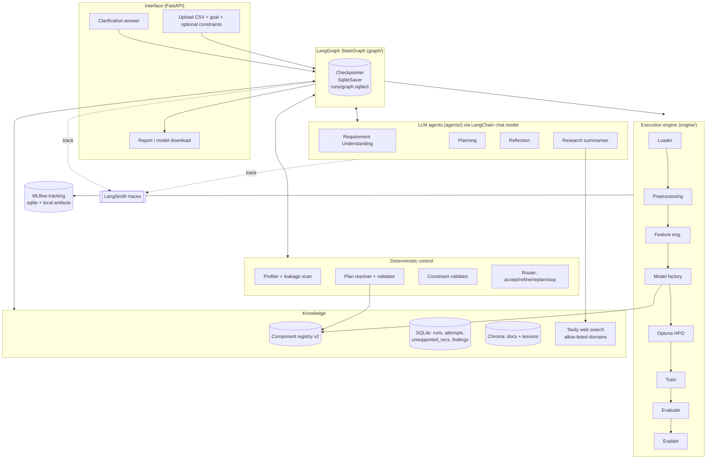

# NeuralPilot — Codebase Audit and Implementation Roadmap

**Audit date:** 2026-10-23
**Code audited:** working tree at commit `4ea97b4` (`src/`, `tests/`, `README.md`, `NeuralPilot-Spec.md`, `pyproject.toml`, `runs/experiments.sqlite3`, `data/`).
`final_year_project.zip` was extracted and diffed: its `src/`, `tests/`, `README.md`, `NeuralPilot-Spec.md` and `pyproject.toml` are **byte-identical** to the working tree. The working tree has more runtime data (35 uploaded CSVs, 6 model artifacts vs 11 CSVs and 2 artifacts in the zip), so the working tree is the audit baseline.

**Evidence labels used throughout**

| Label | Meaning |
|---|---|
| **[VERIFIED-RUN]** | Reproduced by executing the project's code (test suite or a probe script, no LLM involved) |
| **[VERIFIED-DATA]** | Read directly from `runs/experiments.sqlite3` or `data/` |
| **[CODE]** | Read from source; behaviour follows unambiguously from the code but was not separately executed |
| **[INFERRED]** | Likely explanation, not provable from the available evidence |
| **[RECOMMENDATION]** | Design proposal |

**Limitations of this audit**
- No LLM calls were made (they would need your `HF_TOKEN` and send data to Hugging Face). All agent behaviour was tested with scripted fake clients, so LLM output quality is **unverified**.
- `uv` is not on `PATH` in this environment; tests were run with `.venv/bin/python -m pytest` with `PYTHONPATH` unset and `PYTEST_DISABLE_PLUGIN_AUTOLOAD=1`. A ROS Jazzy install on the machine injects pytest plugins that otherwise break collection.
- The web UI was not driven in a browser.
- Probe scripts used for this audit live outside the repo and are reproduced in Appendix A.

---

## Implementation Progress (living section — read this first)

### Rules for every session that continues this roadmap
1. **Read this section before starting work.** It says which phases are done, where the code is, and what was deliberately done differently from the plan below.
2. **When a phase is finished, update this section in the same session**: tick the phase in the status table, add a "Phase N — done" entry (what was built, tests added, verification results, deviations, known limitations), tick the matching items in Deliverable 12, and update "Next up".
3. **Keep the code modular and human-readable:** one responsibility per module, small named functions, docstrings that explain *why*, comments and naming that match the surrounding code, no clever one-liners. Someone new to the project should be able to follow a run by reading `orchestrator.py` → `graph/routing.py` → `graph/nodes.py` → `engine/runner.py` → the engine components.
4. Run tests with `env -u PYTHONPATH PYTEST_DISABLE_PLUGIN_AUTOLOAD=1 .venv/bin/python -m pytest -q -p no:warnings` (ROS plugins break plain `pytest` on this machine). A phase is not done until the full suite passes. `uv` lives at `~/.local/bin/uv` (not on `PATH`); add dependencies with `env -u PYTHONPATH ~/.local/bin/uv add <pkg>`.
5. Where a phase's plan below turns out to be wrong or incomplete, follow the better design, then record the deviation and the reason here.

### Status

| Phase | Status | Date |
|---|---|---|
| 0 — Correctness safety net | ✅ Done (commit `3b08e64`) | 2026-10-24 |
| 1 — Evaluation protocol + engine package split | ✅ Done (commit `3b08e64`) | 2026-10-24 |
| 2 — LangChain LLM layer + LangSmith | ✅ Done (uncommitted, branch `phase2-3`) | 2026-10-24 |
| 3 — LangGraph orchestration | ✅ Done (uncommitted, branch `phase2-3`) | 2026-10-24 |
| 4 — Registry v2, candidates, diversity | ✅ Done (uncommitted, branch `lang`) | 2026-10-24 |
| 5 — Constraint validator + ValidationReport v2 | ✅ Done (uncommitted, branch `lang`) | 2026-10-24 |
| 6 — MLflow tracking | ✅ Done (uncommitted, branch `lang`) | 2026-10-24 |
| 7 — Experiment memory v2 | ✅ Done (uncommitted, branch `lang`) | 2026-10-25 |
| 8 — Documentation RAG | ✅ Done (uncommitted, branch `lang`) | 2026-10-25 |
| 9 — Reflection v2 + deterministic routing | ✅ Done (uncommitted, branch `lang`) | 2026-10-25 |
| 10 — External research | ⏸ Held by the owner (not started) | |
| 11 — Final report, UI, E2E acceptance | ⬜ Not started | |
| 12 — User accounts + persistent run history (design change, not in the original plan) | ✅ Done (uncommitted, branch `lang`) | 2026-10-26 |
| 13 — Web UI redesign to the reference (`NeuralPilot-Reference-UI.html`) | ✅ Done (uncommitted, branch `main`) | 2026-10-26 |
| 14 — Run controls (stop, retry), a readable activity feed, report as text (design change, not in the original plan) | ✅ Done (uncommitted, branch `main`) | 2026-10-26 |

**Next up:** Phase 11 (final report, UI, E2E acceptance). Phase 12 (accounts and run history) is done; its open item is that guidance sends other users' dataset file names to the planner (see Phase 12). The UI must render the report fields added in Phases 4–9: `constraint_table`, `pareto_front`, `unsupported_recommendations`, `mlflow_run_id`, the per-iteration `candidates` log, and now the reflection's `violated_constraints`, `suggestions` and `guard_notes`, and each iteration's routing rationale. Phase 10 (web research) is held by the owner. Still owed from Phases 2–9: one manual run with a real `HF_TOKEN` (this also exercises the reflection v2 prompt and the documentation passages with a real model), a LangSmith key, `mlflow ui`, and a build of the documentation index on the target machine (`python -m neuralpilot.knowledge.ingest`; until then the planner gets no passages).

### Phase 14 — Run controls, a readable activity feed and the report as text — done (2026-10-26)

**What changed.** Four things the console was missing while a run is live:

- **Stop run.** A button in the run header posts to the `/api/runs/{id}/cancel` endpoint that Phase 1 added but nothing called. The run winds down after the trial in flight, so the best attempt is still scored, saved and reported — a finish, not a failure. The button waits ("Stopping…") instead of repeating the request.
- **Retry run.** A failed or interrupted run shows a retry button next to its error. `POST /api/runs/{id}/retry` starts a *new* run from the same upload and goal; the failed one is kept. This needed the upload's path: `run_owners` gained a `dataset_path` column (added in place for existing databases by `accounts.store._add_missing_columns`). A run recorded before the column existed, or whose file is gone, gets "please upload it again" rather than a 500.
- **Tuning shown as one bar.** `ctx.report` and the engine's `progress_callback` take an optional `progress=(done, total)` (`engine/progress.py`). `orchestrator._on_progress` rewrites the previous entry instead of appending when the message repeats with progress, so 20 Optuna trials are one activity line with a tqdm-style bar, not 20 lines. The collapsed entry is what gets stored, so a reopened run reads the same way.
- **Device next to the step.** The same callbacks carry `device`, rendered as *(CPU)* / *(GPU)* in italic after the step name. `model_factory.device_label` reports GPU only for families that actually take GPU parameters (XGBoost, CatBoost), so a host with a GPU does not claim one for a RandomForest. `gpu_is_available` is now cached — it shells out to `nvidia-smi` and is asked once per reported line.

**Verification.** Full suite passes. New tests: retry starts a separate run from the same upload, is refused mid-run, asks for a re-upload when the file is gone, and 404s for another user (`tests/test_web.py`); advancing progress keeps one activity entry and a new stage starts a new one (`tests/test_orchestrator.py`). A scripted-LLM run confirmed the shape of the real log (36 trial lines collapsed to 5, `device` on every execute line). The feed and the two buttons were rendered in headless Chrome against the real module and stylesheet and checked by eye.

**Report text instead of report JSON.** The report header's "Report JSON" dialog is now "Report text": the same findings as the report screen, in reading order, as plain text with the Copy button kept. JSON was the one thing on that page a non-technical user could not read, and it was also the only way to get the report out in one piece. The builder is `web/static/js/report-text.js`, which takes the report object (plus the goal and iteration cap, which the page knows and the payload does not) and returns text — no DOM, so it stays testable. Two readings of the report moved there so the screen and the text cannot drift apart: why a run stopped (`stopKind`) and how assumptions group (`groupAssumptions`). The sprite's `i-braces` icon is replaced by `i-text`.

**Known limitations.** Stopping is offered only while the status is `running` (not while a run waits for clarification). SHAP and profiling lines carry no device; they are CPU-only work and say nothing rather than guessing. The text report drops `constraint_table`, `pareto_front` and `unsupported_recommendations`, which the report screen does not show either (still owed from Phase 11).

### Phase 13 — Web UI redesign to the reference — done (2026-10-26)

**What changed.** The console now follows `NeuralPilot-Reference-UI.html`: a left rail with the user's runs and account footer, a split sign-in page with the "how a run works" panel, a new-run card (drop zone, column preview, goal chips, run settings from the server), a run page with an agent timeline and score chart, and a report page with a score hero and tabs (iterations, top features, data and plan, notes). The reference's simulated data is replaced by the real API. The reference-only screen switcher is left out. Password hint sits on the Password label line, right-aligned.

**Verification.** Full suite passes (328 tests). Driven in headless Chrome against the real server with a scripted LLM: sign-up, upload, clarification, run to finish, View report, JSON dialog, tabs, reopen from the rail, light theme and a 390px phone layout (no horizontal scroll). Screenshots were checked by eye.

**Bugs found and fixed on the way**
- **Polling stopped mid-run after a clarification answer.** The streamed graph values still carried the old `awaiting_clarification` status while the resumed graph started, and `_project` copied it. The page read "awaiting", stopped polling, and never showed the run finishing. Fix: a paused run is "awaiting" only from the graph's interrupt (`_sync_pause`), never from a streamed value. Regression test in `tests/test_orchestrator.py`.
- **Reopening a run from the rail used a stale list status.** The screen is now chosen from the fetched run, not the cached row.
- **Time budget never shown** in the progress panel. Now filled from the server settings.

**Other changes**
- `runs.activity_log_json` (migration 4) stores the activity log when a run finishes, so reopened runs keep their timeline. See Phase 12.
- Old `styles`/`app.js` code paths replaced: `shell.js` (screens and rail), `format.js`, `chart.js` (score chart), `report.js` (split out of `renderers.js`).

**Known limitations**
- The reference has a simulated clock and progress bar. The real run has no start time in the API, so the progress panel shows the time budget but not elapsed time.
- Browser checks were done in headless Chrome only; Firefox and Safari were not tried.

### Phase 12 — User accounts and persistent run history — done (2026-10-26)

**What it does.** Users sign up with email and password and log in. Each user sees, and can reopen, only their own runs (list, report, iteration history, model download). Finished runs are read from the experiment store, so they survive a server restart. Guidance (the experiment store that the planner retrieves from) still draws on every user's finished runs, as before. The documentation RAG index (Chroma) is unchanged.

**Test status:** 327 tests pass (full suite). New: `tests/test_accounts.py` (password hashing, sign-up validation, login, sessions, run ownership), and `tests/test_web.py` gained auth, cross-user isolation, restored-run, interrupted-run and eviction tests. `ruff check --select F,E9` is clean on the touched Python files. `node --check` (ES module mode) passes for every JS file. The browser UI was not exercised in a browser.

**Where the code lives**
- `accounts/` — `store.py` (`AccountStore`: users, sessions, `run_owners`; each call opens its own SQLite connection, so it is safe across threads), `passwords.py` (stdlib scrypt; the cost parameters are stored with each hash).
- `web/auth.py` — `/api/auth/{signup,login,logout,me}` and the `current_user` dependency. Session token in an HTTP-only cookie; only its SHA-256 hash is stored.
- `web/history.py` — rebuilds a finished run's view from the experiment store; builds list rows and the "interrupted" view.
- `web/app.py` — every `/api/runs*` route requires login and checks ownership. `RUNS` now holds only active runs; `_run_in_background` evicts a run once it finalizes or fails.
- Frontend: `js/auth.js` (sign-in page, session check, log out), `js/history.js` ("your previous runs" list), `js/runs.js` (`openRun`), `js/api.js` (auth and list calls; a 401 announces the signed-out state).
- `config.py` — `ACCOUNTS_DB_PATH` (`runs/accounts.sqlite3`), `SESSION_TTL_S` (7 days), `SESSION_COOKIE_SECURE` (env `NEURALPILOT_COOKIE_SECURE=1` for HTTPS).
- `tests/conftest.py` — redirects `DB_PATH` and `ACCOUNTS_DB_PATH` to the per-test directory, so no test writes to `runs/`.

**Deviations from the plan (deliberate)**
- **Ownership is a separate `run_owners` table in `accounts.sqlite3`, not a `user_id` column on `runs`.** A run is owned from the moment it is created, but its experiment row is only written when it finishes. A separate table records the owner at creation, so a run lost in a restart still appears in its owner's list. It also keeps the guidance store and the graph unchanged.
- **In-flight state is not persisted.** Only finished runs are stored. A run that was active when the server restarted is listed as `interrupted`, with the message that its results were not saved. Resuming runs across restarts is out of scope.
- **Activity log is stored once a run finishes.** The web layer saves the live activity log to the new `runs.activity_log_json` column (migration 4) when the run reaches a terminal state, so a reopened run shows its timeline. Runs that finished before this migration have no timeline.
- **Sign-up is open** (no invite, no email verification, no password reset, no rate limiting). These were the decisions taken in the plan.

**Known limitations / open items**
- **Cross-user leakage through guidance.** `agents/planning_agent.py` puts each retrieved past run's `dataset_name` (the uploaded file name) into the planner prompt. Once guidance draws on other users' runs, one user's file name can reach the LLM during another user's run. Decide whether to strip file names from guidance (the planner needs the dataset's shape, not its name) before relying on this for multiple real users.
- Session cookies are not marked `Secure` by default, so they work over plain HTTP on localhost. Set `NEURALPILOT_COOKIE_SECURE=1` when served over HTTPS.
- The uploaded dataset files in `data/` are never deleted, and the model downloads are not versioned per user. Both are unchanged from before.

### Phase 7 + 8 + 9 — done (2026-10-25)

**Test status:** 312 tests pass (full suite, `env -u PYTHONPATH PYTEST_DISABLE_PLUGIN_AUTOLOAD=1 .venv/bin/python -m pytest`), up from 248 at the start of this phase. The one failure carried in from before (`langchain_nvidia_ai_endpoints` not installed in the venv) is gone: `uv add` synced it. `ruff check --select F,E9` is clean on everything this phase touched; two unused `pytest` imports in `tests/test_execution.py` and `tests/test_verification.py` predate this phase and were left alone.

**Where the code lives**
- Phase 7 (experiment memory v2)
  - `memory/migrations.py` — schema v3: `runs.evidence_quality`, the `attempts` table (one row per signature), and the backfill that marks legacy churn runs without a report as `suspect_leakage`.
  - `memory/store.py` — `ExperimentRepository` (moved from `repository.py`, which is now a re-export shim), `save_attempts`/`attempts_for_run`, and `is_usable_evidence` (finalized, not suspect, every plan component still in the registry, final model feasible).
  - `memory/similarity.py` — `memory_vector` v2 (10 dimensions) and `similarity`. Legacy records read the new dimensions as neutral 0.
  - `meta_features.py` — `text_ratio`, `datetime_present`, `mean_abs_skew_numeric`.
  - Warm start: `candidates.WarmStart`, `CandidatePlan.warm_start_params`, `AttemptSummary.best_params`; `engine/hpo.py` declares the search space as Optuna distributions, `within_space` filters stored params against them, and `tune` enqueues the survivors as the first trial; `engine/runner.py` threads `warm_start_params` through.
  - `scripts/benchmark_memory.py` — memory-on versus memory-off benchmark.
  - Tests: `tests/test_memory.py` (17 tests), `tests/test_candidates.py` (+2).
- Phase 8 (documentation RAG)
  - `knowledge/` — `chunks.py` (heading sections, 450-word windows with 60-word overlap, content-hash ids), `fetch.py` (allow-listed hosts, main-content extraction, stdlib HTML parser), `sources.py` (validates `knowledge_sources/*.yaml`: host, registry component ids, task types, trust), `store.py` (Chroma wrapper; `open_index()` returns `None` when no index exists), `registry_cards.py` (one card per registry component, rebuilt on every ingest), `retrieve.py` (templated dataset query, task and registry filters, `check_citations`), `ingest.py` (offline CLI), `evaluate.py` (recall@5 and MRR on labelled queries).
  - `knowledge_sources/` — 15 official pages in five YAML files. `tests/rag_eval/queries.yaml` — 36 labelled queries.
  - Planner: `PlanSpec.evidence_ids`; the prompt lists passages with their ids; `resolve_plan` drops ids that were not retrieved. `graph/context.py` carries the index; `retrieve_knowledge` fills `knowledge_passages`; a retrieval failure is logged and the run continues without passages.
  - Tests: `tests/test_rag.py` (27 tests, offline, using a local hashing embedding).
- Phase 9 (reflection v2 and deterministic routing)
  - `schemas.py` — `ReflectionOutput` v2 (`diagnosis`, `violated_constraints`, `proposed_action`, `suggestions`, `expected_effect`, `confidence`, `guard_notes`; all optional, so the old two-field reply still parses), `ReflectionSuggestion`, `ProposedAction`.
  - `agents/reflection_agent.py` — prompt shows failing constraints and attempts executed so far; a claimed violation that does not match a failing constraint is sent back once, and anything still unmatched is dropped and noted.
  - `reflection_guard.py` — `split_violated_claims`, `suggestion_plan`, `usable_suggestions` (resolved through the registry, de-duplicated against executed signatures). The `reflect` node keeps only usable suggestions; if every suggestion is dead, `proposed_action` becomes `none`.
  - `graph/decision.py` — `decide_route`, a pure function: cancel → budget → iteration cap → accept → plateau → refine → replan. Table-tested in `tests/test_decision.py`.
  - `agents/decision_agent.py` deleted. The `decide` node is deterministic.
  - Tests: `tests/test_reflection_v2.py` (14 tests), `tests/test_decision.py` (14 tests).

**Verification**
- Real ingestion (`python -m neuralpilot.knowledge.ingest`): 15 pages, 313 passages, 17 registry cards; index size 330, stored in `runs/knowledge/chroma` (git-ignored). The first run downloads Chroma's default embedding model (`all-MiniLM-L6-v2`, about 80 MB).
- Retrieval on the 36 labelled queries (labels written from page contents before any retrieval ran): recall@5 = 0.944, MRR = 0.907. The two misses are both target-encoding queries ("target encoding ... cross fitting", "why target encoding can leak"). Not tuned after seeing results.
- Memory benchmark (churn training file as the past run, churn testing file as the target, GradientBoosting, two seeds): BENCHMARK_RESULT_PLACEHOLDER

**Deviations from the plan (deliberate)**
- **Every run now takes at least two iterations unless a guardrail stops it earlier.** Accept is never granted on iteration 1 (Phase 9 "no LLM-only stop/accept on iteration 1", read as requiring a measured change). A first plan that is already good therefore pays for one more iteration of HPO. Flagged for the owner to decide whether iteration 1 may accept when the best attempt is feasible and nothing is proposed.
- **The LLM Decision Agent is removed.** Its narrative role is not kept; the decision rationale is the rule's own text.
- **Refine needs a proposed change.** A reflection with only the old fields (no `proposed_action`) now replans rather than refines.
- **Legacy migration keys on the audit's rule, not on the leakage check itself.** A finalized run with no stored report whose dataset name contains "churn" is marked `suspect_leakage`. The workspace database holds no rows, so the migration is tested only on a synthetic legacy database.
- **Phase 7 features not built:** `n_id_columns_dropped` (ID detection lives in the engine's profiling, not in meta-features).
- **Phase 8 features not built:** MMR diversification (passages are the top-k nearest that pass the filters), the `lessons` collection, `scripts/ingest_docs.py` (the module CLI replaces it), and the research path (Phase 10).
- **Warm starts are one trial, not a seeded study.** The best stored parameters are enqueued as the first trial and count toward the trial cap. Only the same model family's parameters transfer.
- **Suggestions are advisory.** Usable reflection suggestions go to the planner's refine prompt; they are not executed directly.

**Known limitations / open items carried forward**
- Live checks still owed from Phases 2–9: a real HF run (this exercises the reflection v2 prompt and the passages with a real model), a LangSmith trace, `mlflow ui`, and building the documentation index on the target machine.
- Passage quality on the two target-encoding misses is unexplained; the index has not been inspected for those pages.
- Reflection's `expected_effect` and `confidence` are recorded but nothing reads them yet.
- The memory benchmark ran on one dataset pair with two seeds. It shows whether the warm start works on this pair, not whether memory helps in general.

### Phase 4 + 5 + 6 — done (2026-10-24)

**Test status:** 248 tests pass: the 178 that passed at the start of this phase (three changed on purpose, see below) plus 70 new. The full suite passes with `env -u PYTHONPATH PYTEST_DISABLE_PLUGIN_AUTOLOAD=1 .venv/bin/python -m pytest`. `ruff check --select F` is clean on the files this phase touched. Real-data smoke run (not in the test suite): the churn testing file (`CustomerID` excluded; planner `LinearModel` 0.838 CV f1, challenger `HistGradientBoosting` 0.9997 selected; holdout 0.9998; 125 s with 6 HPO trials per candidate).

**Where the code lives**
- Phase 4
  - `registry.py` — `ComponentSpec` v2 fields (`aliases`, `semantic_group`, `alternatives`, `resource_class`, `max_rows_hint`); `find_component` (name or alias), `components_supporting`, `default_component`, `get_model_group`. New: `TargetEncoder`, `HistGradientBoosting`, `ExtraTrees`.
  - `plan_resolution.py` — `resolve(plan, profile, …) -> ResolvedPlan | PlanRejection`. Exact/alias match, else a ranked alternative (same semantic group first; score = 0.4·task + 0.25·data + 0.2·memory prior + 0.15·(1−cost)). Substitutions are returned as `UnsupportedRecommendation`s. Encoder swaps across groups only for tree models. Hard glass-box requirements replace black-box families.
  - `candidates.py` — `build_candidates`: the planner's plan first, then a `baseline` (LinearModel, else DecisionTree), a `profile` family (HistGradientBoosting above 50k rows, ExtraTrees at 5k rows or fewer), and a `memory` warm start from the best similar past plan. Capped at `config.MAX_CANDIDATES` (default 3); executed signatures and black-box families (under glass-box) are excluded.
  - `engine/runner.py` — `run_attempt` accepts `tracking_tags` and always closes its tracker run; `engine/model_factory.py`, `engine/hpo.py` — class weights and search spaces for the two new families.
  - `graph/nodes.py` — `resolve_plan` resolves the plan and builds challengers; `execute` measures every candidate (planner first; a failing challenger is logged, not fatal; challengers are skipped when cancelled or under `CHALLENGER_MIN_BUDGET_S`); `IterationLog.candidates` records each one.
  - `repository.py` — migration 2: `runs.mlflow_run_id` and the `unsupported_recommendations` table (`save_unsupported`, `unsupported_for_run`).
  - `agents/planning_agent.py` — the prompt lists components the run could not use, with the alternative that was used.
- Phase 5
  - `schemas.py` — `Constraint` (names: `min_primary_metric`, `max_latency_ms_per_1k`, `max_train_seconds`, `max_model_mb`, `max_cv_std`, `interpretability`; `kind` hard/soft), `ConstraintResult`. `RequirementSpec.constraints` drops invalid entries and notes them in `assumptions`. `AttemptSummary` carries `feasible`, `constraint_results`, `latency_ms_per_1k`, `interp_norm`, `source`.
  - `validation/constraints.py` — checks on measured `AttemptResult` values; deterministic explanation text (e.g. `latency 82.0 ms/1k > 50.0 ms/1k limit (+64%)`). `requires_glass_box`, `is_feasible`.
  - `validation/report.py` — `evaluate_attempt`, `pareto_front` (metric, latency, interpretability), `closest_per_violation`, `summarize_run`.
  - `selection.py` — `is_better` is feasibility-first, then the existing CV rule.
  - `agents/requirement_agent.py` — the prompt asks for constraints with a fixed name list.
  - `graph/nodes.py` — `decide` refuses to accept while the best attempt misses a hard constraint and iterations/budget remain (`forced` refine).
  - `reporting.py` — the final report gains `constraint_table`, `feasible`, `acceptable`, `feasible_count`, `pareto_front`, `closest_per_violation`, `best_plan`, `unsupported_recommendations`, `mlflow_run_id`; substitutions appear in `assumptions`.
- Phase 6
  - `engine/tracking.py` — `Tracker` protocol (`start_parent`, `start_attempt`, `log_metrics`, `log_artifact`, `end_attempt`, `log_final`, `end`), `NoopTracker`, `make_tracker`.
  - `engine/mlflow_tracker.py` — `MlflowTracker`: one parent run per NeuralPilot run (tags, `holdout_*` metrics, `final_report.json`, `load_report.json`, the model), one child run per candidate (params, `cv_*` metrics, `latency_ms_per_1k`, `plan.json`). Every call is guarded.
  - `config.py` — `MAX_CANDIDATES`, `MIN_TRIALS_PER_CANDIDATE`, `HIST_GB_MIN_ROWS`, `SMALL_DATA_ROWS`, `CHALLENGER_MIN_BUDGET_S`, `GLASS_BOX_CLASSES`, `MLFLOW_*`.
  - `graph/state.py` / `context.py` / `orchestrator.py` — `mlflow_run_id` in state (so a resumed run keeps its parent); the tracker is built per invocation from the checkpointed parent id.
- Tests (new): `tests/test_registry_v2.py`, `tests/test_plan_resolution.py`, `tests/test_candidates.py`, `tests/test_constraints.py` (includes an end-to-end run with an impossible limit), `tests/test_model_diversity.py` (a tree family wins on an interaction, and the linear model was still measured), `tests/test_tracking.py` (real MLflow store under `tmp_path`: parent and child runs, saved model reloads to the same predictions, tracking failure does not fail the run). Also one repository round-trip test. The `conftest.py` autouse fixture turns MLflow off and points every store at `tmp_path`.

**Verification**
- `test_saved_model_reloads_to_the_same_predictions` runs `log_model` + `mlflow.sklearn.load_model` on pandas 3.0.5 with MLflow 3.17.2: this is the Phase 6 gate from Deliverable 11.1. It passes, so full `mlflow` stays (no fallback to `mlflow-skinny`).
- Unsafe substitution is refused: a plan whose only component cannot run the task is rejected with the list of components that can.
- Test runs no longer write into `runs/`: the first version of the conftest let MLflow write `runs/mlflow.db`; those files were deleted and the fixture fixed.

**Deviations from the plan (deliberate)**
- **Candidates are a list in state, not a `PlanSpec.candidates` field.** The planner still produces one plan, which is the one reflected on and refined. Challengers are deterministic. This keeps the LLM contract and the refine logic unchanged.
- **Budget split is equal, not successive halving.** Each candidate gets `HPO_MAX_TRIALS // n` trials (floor `MIN_TRIALS_PER_CANDIDATE` = 5) and `timeout / n`. Halving needs resumable Optuna studies, which `tune` does not have yet. Consequence: with the default cap of 50 and 3 candidates, the planner's own plan now gets 16 trials per iteration instead of 50. Set `NEURALPILOT_MAX_CANDIDATES=1` to restore the old behaviour.
- **Model artifact uses cloudpickle, not MLflow's default skops format.** skops rejects `sklearn.tree._tree.Tree`, so the default cannot log a random forest. The store is local and written by this process, which is the case where pickle is acceptable. MLflow logs a warning about this on every save.
- **Signature only, no input example.** The model signature lists column names and types (`double`/`string`) with no rows, as the design requires.
- **`ComponentSpec` v2 is partial.** Not added: `input_types`, `handles_missing`, `native_categorical`, `needs_scaling`, `param_schema` (the existing per-component validators in `engine/preprocessing.py` still do this job), `explainers`, `dependency`, `status`, and `registry_version`. Feature engineering is still an engine concern, not a registry category.
- **LightGBM is not added.** It is optional in Deliverable 8.1 (only if the compatibility check passes). `HistGradientBoosting` covers the same role without a new native dependency, and LightGBM can be registered later.
- **`TargetEncoder` substitutes only for tree models across groups.** It is registered (cross-fitted inside `fit`, so it is safe in CV), but a linear model never gets a target-encoded feature by substitution.
- **Selection tie-breaks** use the existing composite score. The design's "lower latency, then higher interpretability" tie-break is not implemented.
- **Constraints come from the requirement agent only.** The web form fields listed as optional in Phase 5 are not added.
- **Plateau detection** still uses the composite score of the planner's plan, not the best feasible attempt.
- **Resolution uses the training row count** (`n_train`) for the over-budget check, not the full row count.
- **Reflection does not see constraint failures yet.** That is Phase 9 (Deliverable 9.5).
- **Not built:** `scripts/registry_gaps.py`, `scripts/model_selection_report.py`, and `registry_version` hashes. The data they need is recorded (`unsupported_recommendations`, `IterationLog.candidates`).

**Known limitations / open items carried forward**
- The planner's prompt does not mention that challengers exist, and the planner cannot see challenger results beyond the "Already tried" list (which includes them).
- A replan can now re-ask the planner when its proposed plan equals a challenger that was already measured. This is correct (the signature was executed), but it uses one of the planner's `MAX_PLAN_ATTEMPTS` retries.
- `TargetEncoder` and `HistGradientBoosting` have only the synthetic and churn runs behind them; no real LLM has proposed them yet.
- MLflow's UI was not opened in a browser; `mlflow ui --backend-store-uri sqlite:///runs/mlflow.db` is the suggested check.
- Still owed from before: a real `HF_TOKEN` run and a real LangSmith trace (see Phases 2–3).

### Phase 2 + 3 — done (2026-10-24)

**Test status:** 174 tests pass: the 126 from Phase 0/1 (three updated, see below) plus 48 new.

**Where the code lives**
- `src/neuralpilot/langchain_llm.py` — `LangChainLLMClient` (same `complete_json` protocol), `build_chat_model` (`ChatHuggingFace` over HF Inference Providers, same `HF_*` settings), `call_with_backoff` / `is_transient`.
- `src/neuralpilot/llm_client.py` — protocol and original `HFLLMClient` unchanged; `get_default_client()` picks the backend from `NEURALPILOT_LLM_BACKEND` (`langchain` default, `hf` rollback).
- `src/neuralpilot/observability.py` — `run_tracing()`, `traced()`, `redact_payload()`, `redaction_hooks()`, `tracing_status()`.
- `src/neuralpilot/graph/` — `state.py` (`NPState` TypedDict, reducers, checkpoint type allowlist), `context.py` (`RunContext`: repo, cancel flag, progress callback, optional LLM client), `resources.py` (bounded caches for DataFrames, `PreparedData`, best pipeline), `nodes.py` (one function per step), `routing.py` (pure routers + `recursion_limit`), `build.py` (wiring, error guard, `SqliteSaver`).
- `src/neuralpilot/orchestrator.py` — now a façade: `create_run`, `run_to_completion`, `apply_clarification`, and `RunState` as the UI projection of graph state. `web/app.py` did not need changes.
- `src/neuralpilot/selection.py` (`is_better`, `next_untried_plan`) and `src/neuralpilot/reporting.py` (final report, finalized/failed records) — logic moved out of the old orchestrator unchanged.
- `schemas.py` — `IterationLog` and `BestAttempt` are now Pydantic models (they live in checkpointed state).
- Tests: `tests/test_llm_adapter.py`, `tests/test_tracing_redaction.py`, `tests/graph/test_routing.py`, `tests/graph/test_graph_e2e.py`, a full web-flow test in `tests/test_web.py`, and `tests/conftest.py` (sends checkpoints and models to a temp dir).

**Phase 2 — LangChain + LangSmith**
- Each call first asks the provider for structured output (`with_structured_output`, method from `NEURALPILOT_LLM_STRUCTURED_METHOD`, default `function_calling`), then falls back to plain chat + the existing JSON-repair loop. A capability error (provider has no tool calling) switches structured output off for that client; a reply that just doesn't fit the schema falls back for that call only. `NEURALPILOT_LLM_STRUCTURED_OUTPUT=auto|on|off`.
- Transport retries (429/408/5xx, timeouts, dropped connections): ≤ 3 attempts, exponential backoff with jitter, separate from JSON-repair retries. Client errors (400/401) are raised at once.
- Tracing: when `LANGSMITH_TRACING=true`, one run = one trace (`neuralpilot_run`), with a span per graph node, per agent (`requirement_agent`, `planning_agent` with iteration/replan metadata, `reflection_agent`, `decision_agent` with iteration) and per LLM call. Root and LLM spans carry `run_id`, `dataset_fingerprint`, `code_version`, `llm_backend`, `llm_model`.
- Redaction (inside LangSmith's own `hide_inputs`/`hide_outputs`, plus `process_inputs` on agent spans): keys like `df`, `rows`, `sample`, `api_key`, `token`; any DataFrame/Series/ndarray; `shap_summary` (one-hot feature names contain category values); and the values of `HF_TOKEN`, `LANGSMITH_API_KEY`, `TAVILY_API_KEY` wherever they appear.
- Startup log prints the backend/model and whether tracing is on (never the key).

**Phase 3 — LangGraph**
- Graph: `understand → [clarify] → prepare → retrieve_knowledge → start_iteration → plan → resolve_plan → execute → reflect → decide → (start_iteration | finalize → persist)`, with `fail` reachable from every node. Diagram in the `graph/routing.py` docstring.
- Every node is wrapped so an exception becomes `error` in state and the routers send it to `fail`, which persists the run as failed. Interrupts pass through. Errors that escape the graph (e.g. the recursion limit) are caught by the façade and persisted too.
- Clarification is `interrupt()` + `Command(resume=…)`. The façade validates the answer first (bad answer → HTTP 400, run keeps waiting, as before); the `clarify` node re-validates, re-asks once, then fails (`MAX_CLARIFICATION_ROUNDS = 2`).
- Checkpoints: `SqliteSaver` at `runs/graph.sqlite3`, `thread_id = run_id`, `durability="sync"`. The serializer only rebuilds NeuralPilot's own schema classes (checked with `LANGGRAPH_STRICT_MSGPACK=true`). State holds no DataFrames or fitted models.
- Crash recovery: re-calling `run_to_completion` continues from the last finished node; a test kills the run inside `reflect` and checks the attempt is not trained again and the pipeline is reloaded from disk.
- `recursion_limit` is computed from `max_iterations`, plan retries and clarification rounds (60 for 5 iterations).

**Verification**
- Graph scenarios: accept at 1, refine → accept, replan → different plan, duplicate plan → re-ask → deterministic fallback, verification failure ×3 → failed + persisted, budget exhausted → best so far, cancel before any attempt → failed, iteration cap → best so far, clarification pause/resume, invalid answer inside the graph → re-ask → fail, recursion limit → failed + persisted, finished run is not re-executed.
- Web: `TestClient` test with the real background thread: upload → awaiting clarification → answer → finalized → model download.
- Tracing: a whole run traced into a capturing LangSmith client; no category values and no `HF_TOKEN` in any payload; ≥ 4 LLM spans with `run_id`. Removing the `shap_summary` redaction makes this test fail (checked).
- Real `ChatHuggingFace` exercised with a stubbed `InferenceClient`: the tool definition is sent and the tool call is parsed; a provider that ignores tools still works through JSON repair.

**Not verified (needs your credentials; nothing was sent to Hugging Face or LangSmith)**
- Whether `meta-llama/Llama-3.3-70B-Instruct` via `HF_PROVIDER=auto` honours tool calling (`function_calling`) or `json_schema`. If structured output keeps failing, the log says so once and the JSON-repair path is used; try `NEURALPILOT_LLM_STRUCTURED_METHOD=json_schema`.
- A real LangSmith trace. Suggested check: `LANGSMITH_TRACING=true NEURALPILOT_MAX_ITERATIONS=2 uv run neuralpilot`, run one dataset, confirm one trace with node, agent and LLM spans.
- The web UI in a browser (the JSON it polls is unchanged).

**Deviations from the plan (deliberate)**
- **Old loop deleted, no `NEURALPILOT_ORCHESTRATOR=legacy` switch.** Keeping two orchestrators would double the code that has to stay in sync; rollback is `git revert` to `3b08e64`. The `NEURALPILOT_LLM_BACKEND=hf` switch is kept, because LLM behaviour is the unverified part.
- **No separate `validate` node yet.** Scoring and best-attempt selection run inside `execute`, because the fitted pipeline cannot be put in state and must be kept or dropped in the step that produced it. The best pipeline is held in memory and written to `runs/models/<run_id>.joblib` whenever it improves (so a resumed run can finalize). Phase 5's validator works on `AttemptResult`s only and can become its own node then.
- **Decision agent kept as an LLM node** (behind the same guardrails). The roadmap's deterministic `route` node belongs to Phase 9; Phase 3 was a behaviour-preserving port.
- **Retrieval runs once per run** (`retrieve_knowledge`), not every iteration; the result could not change mid-run.
- **Budget clock starts at `prepare`**, after clarification, so time waiting for the user no longer counts against `RUN_BUDGET_S`.
- **No `ChatPromptTemplate`s.** The `LLMClient` protocol takes plain strings and the prompts contain literal JSON braces that templates would need escaped; converting them adds risk for no gain until prompts are versioned (LangSmith datasets, P2).
- **No LangGraph `RetryPolicy`.** Transport retries already happen in the adapter; a second layer would multiply retries.
- **Structured output gets a JSON Schema dict, not the Pydantic class**, because `ChatHuggingFace` raises "Pydantic schema is not supported for function calling". The reply is validated against the Pydantic model either way.

**Known limitations / open items carried forward**
- Per-agent temperature (0 for requirement understanding, ≤ 0.3 for planning) is not set; all calls use `LLMConfig.temperature` (0.2). It needs a protocol change that would break the test fakes' signature.
- `NEURALPILOT_PRIVACY_MODE` column aliasing and LangSmith feedback scores (`constraints_passed`, holdout metric on the root run) are not implemented; they fit Phase 5/11.
- `runs/graph.sqlite3` is never pruned. The web app still keeps `RUNS` in memory, so after a restart the UI cannot list old runs even though their checkpoints exist (restart-safe run listing is P2).
- Existing tests changed on purpose: the "best iteration" test loads the saved model instead of reading `state.best.outcome.pipeline` (fitted pipelines are no longer in run state); the holdout spy patches `graph.nodes.holdout_evaluate`; `MODELS_DIR` is patched on `config` via `tests/conftest.py`.

### Phase 0 + 1 — done (2026-10-24)

**Test status:** 126 tests pass (the original 56, some updated where the contract intentionally changed, plus 70 new).

**Acceptance probe (real 440k-row churn file, the audit's old plan: GradientBoosting + SelectKBest + OptunaTPE(50), no LLM):**

| Check | Result |
|---|---|
| `CustomerID` | Excluded as an identifier |
| HPO | Stopped at the 300 s timeout after 14 of 50 trials; tuned on a 50k-row sample |
| CV f1_weighted (training split) | 0.969 |
| Holdout f1_weighted | 0.968, scored once |
| Latency | 18.8 ms per 1k rows |
| Total time | 457 s, within the 900 s run budget (audit estimate for this plan was ~76 min per iteration) |

**Where the code lives**
- `src/neuralpilot/engine/` — `loader`, `splits`, `preprocessing`, `feature_engineering`, `model_factory`, `hpo`, `training`, `evaluation`, `explainability`, `tracking` (no-op `Tracker` seam for Phase 6), and `runner` (`prepare_dataset` → `run_attempt` → `holdout_evaluate`, plus `plan_signature`).
- `src/neuralpilot/execution.py` — `run_pipeline()` kept as a thin compatibility wrapper over the engine.
- `src/neuralpilot/profiling.py` — column roles and leakage scan; `derive_problem_type`.
- `src/neuralpilot/provenance.py` — git SHA (+dirty flag) and library versions.
- `src/neuralpilot/orchestrator.py` — `BestAttempt`, `AttemptSummary` history, `_obtain_plan` (verify → dedupe → deterministic fallback), budget/cancel guardrails, `_finalize` (single holdout), `_persist_failure`.
- `src/neuralpilot/repository.py` — `PRAGMA user_version` migrations, new columns, `SimilarExperiment(record, similarity)`.
- Tests: `tests/test_loader.py`, `tests/test_profiling.py`, `tests/test_orchestrator_loop.py`, `tests/test_web.py`, `tests/engine/test_engine.py`, `tests/engine/test_splits.py`, fixtures in `tests/fixtures/`.

**Phase 0 (G1–G11)**
- **Loading (G5):** `engine/loader.py` detects `;`, tab and `|` delimiters, falls back through utf-8, utf-8-sig, cp1252 and latin-1, converts `"1,000"`-style text to numbers, and rejects junk headers, single-column, tiny and oversized files with a message that says how to fix the file.
- **Leakage (G2):** `profiling.py` labels each column as id, constant, datetime, text, categorical or numeric, and flags columns that predict the target almost perfectly on their own (single-feature depth-3 tree, CV, on training rows only). ID, constant, datetime and text columns are excluded and listed in the report. Flagged columns are excluded too, unless `NEURALPILOT_LEAKAGE_ACTION=warn`.
- **One metric (G8):** a single primary metric drives tuning, selection and the report: `f1_weighted` by default, `f1_macro` with balanced class weights when the smallest class is under 10%, `r2` for regression. A user-requested metric is honoured when valid.
- **Latency (G6):** measured as the median of 3 predictions on a fixed 1,000-row sample, in ms per 1k rows, normalised against a fixed reference (`LATENCY_REFERENCE_MS_PER_1K`). The same attempt gets the same score in any iteration.
- **Budgets (G9):** Optuna trials capped (`HPO_MAX_TRIALS`), Optuna timeout, per-run wall-clock budget (`RUN_BUDGET_S`), HPO/CV on a sample of large data (`HPO_MAX_ROWS`), bounded feature-engineering and preprocessing params. Clamped or dropped values are recorded as assumptions.
- **Best attempt and single holdout (G1, G7):** attempts are compared on CV over the training split (primary-metric mean; within one standard error, the composite score breaks the tie). The best one, not the last, is saved and scored once on the holdout.
- **No repeated plans (G3):** the planner sees the plans already tried with their CV scores, and is told when a replan should change strategy. If it repeats a plan it is asked once more, then the next untried registry model is used instead.
- **Retrieval (G4):** past runs are compared on a scaled meta-feature vector (`meta_features.memory_vector`), filtered to finalized runs of the same task type, and dropped below `MIN_SIMILARITY`. The planner sees the similarity score.
- **Persistence (G10):** failed runs are saved, with decision rationale, whether a guardrail forced the decision, iteration logs, metrics (CV and holdout), model path, code and library versions, and a dataset fingerprint. Existing databases upgrade in place.
- **Clarification (G11):** the answer is matched to a column ignoring case; otherwise the endpoint returns 400 with the column list and the run keeps waiting. The task type is re-derived from the chosen column. An LLM-proposed target that is not a column also triggers clarification.

**Phase 1**
- `execution.py` split into the `engine/` package above, plus `splits.py` (stratified, random, group or time-ordered; one holdout per run, CV folds drawn from the training part only).
- New schemas: `SplitSpec`, `MetricSummary`, `ResourceUsage`, `AttemptResult`, `AttemptSummary`. Results include per-fold CV summaries and resource usage (train/HPO seconds, peak RSS, latency, model size).
- Optuna uses fold-by-fold `MedianPruner`, catches failed trials, and stops on a cancellation event. `POST /api/runs/{id}/cancel` stops after the current trial and keeps the best attempt.
- Golden/determinism tests, holdout-isolation spy tests, time-split and group-split tests.

**Deviations from the plan below (deliberate)**
- **Plan signature** also includes the tuner, trial count and FE/preprocessing params. Otherwise a refine that only changes hyperparameters would be rejected as a duplicate.
- **Regression leakage** uses max(depth-3 tree CV R², Spearman ρ²). A depth-3 tree alone cannot reach R² ≥ 0.98 on a continuous target, so it would miss a copy of the target.
- **Task re-derivation:** an integer target with under 5% unique values counts as classification only if it also has 50 or fewer distinct values. The plan's rule alone would turn large regression datasets into classification.
- **Datetime and free-text columns** are excluded as well as id and constant columns, because one-hot encoding them is harmful. Unique single-token string columns (emails, codes) count as identifiers.
- **SHAP** runs once at finalisation on training rows (not per attempt), so explanation never touches the holdout.

**Known limitations / open items carried forward**
- The Optuna timeout is only checked between trials, so one slow trial can overrun it (churn: 322 s against a 300 s limit).
- The student and winequality CSVs are no longer in `data/`; `;` and cp1252 handling is tested with synthetic fixtures in `tests/fixtures/`. Re-run the six real datasets when available.
- No real LLM calls were made and the web UI was not driven in a browser. The UI still reads the old report fields; the new ones (`cv_metrics`, `holdout_metrics`, `best_iteration`, `best_hyperparameters`, `data.excluded_columns`, `reproducibility`) are not displayed yet.
- The model artifact is still a bare pipeline without the label decoder (G20, planned for later).
- Existing tests changed on purpose: scoring tests use absolute latency, retrieval returns `(record, similarity)`, and the GPU test patches `engine.model_factory.gpu_is_available`.

---

## Deliverable 1 — Executive Assessment

### What already works
NeuralPilot has a clean, deliberately small baseline that is worth keeping:
- A **deterministic execution engine** ([execution.py](src/neuralpilot/execution.py)) that builds a real scikit-learn `Pipeline` (impute → scale/encode → optional FE → model). It tunes with Optuna using 3-fold CV **on the training split only**, evaluates on a held-out 20% split, and can compute a SHAP top-10 summary. Preprocessing is fitted inside the pipeline, so there is **no fold-level preprocessing leakage**.
- A **component registry with deterministic fallback** ([registry.py](src/neuralpilot/registry.py)): 2 encoders, 3 scalers, 6 model families, 3 tuners.
- **Rule-based plan verification** ([verification.py](src/neuralpilot/verification.py)), **weighted scoring** ([scoring.py](src/neuralpilot/scoring.py)) and **plateau detection** ([plateau.py](src/neuralpilot/plateau.py)).
- Four **LLM agents** with Pydantic-validated JSON output plus a JSON-repair retry ([llm_client.py](src/neuralpilot/llm_client.py)), behind an injectable `LLMClient` protocol, so they are testable without a network.
- A **hand-written orchestration loop** ([orchestrator.py](src/neuralpilot/orchestrator.py)) with one clarification pause, a FastAPI UI ([web/app.py](src/neuralpilot/web/app.py)), and SQLite experiment logging ([repository.py](src/neuralpilot/repository.py)).
- **55/55 tests pass** in 12.8 s [VERIFIED-RUN].

### Most critical findings
These are correctness problems, not missing features. Each is evidenced below in Deliverable 2.

1. **Leaky models are reported as successes.** In the churn dataset, `CustomerID` alone predicts `Churn` with **99.0% accuracy** (base rate 56.9%) [VERIFIED-RUN]. The engine feeds ID columns to the model as numeric features [VERIFIED-RUN], and 3 of the 6 persisted runs are this leaky churn model, with composite score 0.856.
2. **The final model can be worse than an earlier iteration.** `_finalize()` saves the *current* iteration's pipeline, not the best one. A scripted run scored `[0.8751, 0.8374]` and saved the 0.8374 model [VERIFIED-RUN].
3. **"Replan" cannot produce a different plan.** On `replan`, the planner receives a prompt **byte-identical** to iteration 1's [VERIFIED-RUN]. Combined with degenerate retrieval (finding 4), this is the main driver of "the same model every time".
4. **Experiment retrieval is effectively random/recency-based.** Cosine similarity over the unscaled vector `[n_rows, n_cols, …]` is dominated by `n_rows`. Every pair of stored runs has similarity ≥ 0.99993 [VERIFIED-DATA]. Retrieval also ignores `problem_type`.
5. **Every persisted run used the same plan and stopped after one iteration.** All 6 runs: `GradientBoosting + SelectKBest + OptunaTPE(50)`, `scores` length 1, decision `stop` [VERIFIED-DATA]. The reflection/refinement loop has never been exercised on real data.
6. **Common CSVs fail before any agent runs.** `;`-separated files (student, winequality) load as a single column, and non-UTF-8 files (spotify-2023) are rejected [VERIFIED-RUN]. About 29 of 35 uploads never produced a persisted run, and failed runs are not recorded anywhere [VERIFIED-DATA].
7. **The score is not comparable across iterations.** Latency is normalised against the run's rolling maximum, so iteration 1 always gets `latency_norm = 1.0`. The *same* model scores 0.720 as iteration 1 and 0.840 later [VERIFIED-RUN].
8. **The holdout test set is used for model selection across iterations.** Every iteration uses the same `random_state=42` split, and the decision loop compares holdout scores. The reported metric is therefore optimistically biased [CODE].
9. **No compute budget.** One Optuna trial plus final fit on churn (440k rows) took 91 s, so the chosen 50-trial plan implies about 76 min per iteration. Nothing caps `n_trials` (an LLM-supplied integer), FE parameters, or wall-clock time [VERIFIED-RUN].

### Required-technology status [VERIFIED-RUN]
`langchain`, `langchain-core`, `langgraph`, `langsmith`, `mlflow`, `lightgbm`, `chromadb`, `faiss-cpu`, `sentence-transformers` and `tavily-python` are **not installed and not imported anywhere** in `src/` or `tests/`. The spec deliberately deferred the vector DB, web search and RAG ([NeuralPilot-Spec.md §2](NeuralPilot-Spec.md)). MLflow, LightGBM, LangChain/LangGraph and target encoding are named in the project PDF but absent.

### Recommended target architecture (summary)
- Keep the existing modules as the **business-logic layer**.
- Make **LangGraph** the orchestrator: a single `StateGraph` whose nodes are thin wrappers around existing functions. Clarification uses `interrupt()` with a SQLite checkpointer.
- Use **LangChain** only at the LLM boundary (chat model + structured output) behind the existing `LLMClient` protocol, and use **LangSmith** for tracing with input/output redaction.
- Fix the **evaluation protocol**: CV for selection, holdout used once, absolute latency, best-so-far, constraint-aware selection.
- Upgrade the **registry** into a capability catalogue with param schemas and explicit alternatives, plus an `unsupported_recommendations` table.
- Use **MLflow** for per-attempt params/metrics/artifacts, with SQLite remaining the application's system of record (runs, attempts, memory).
- Use **two retrieval paths**:
  1. *Experiment memory* is structured: meta-feature nearest-neighbour in SQLite/NumPy, which needs no vector DB.
  2. *Documentation/lessons RAG* uses one embedded vector store (Chroma, as named in the PDF).
- **Web research** is advisory: it produces recorded findings and only triggers controlled experiments for components already in the registry. It never installs packages at runtime.

### Feasibility
The complete plan is **feasible** for a local, single-machine, final-year-project scope. No cloud infrastructure is required. The riskiest parts are LLM output reliability with an open-weights model via HF Inference, and dependency compatibility with the project's `pandas>=3` / `numpy<2.5` pins (see Deliverable 11). Web-research-driven "SOTA adoption" must stay narrow: it can find and test registry-compatible tabular methods, but it cannot safely auto-integrate arbitrary new libraries.

### Highest-priority changes, in order
1. **Phase 0** — fix the nine correctness defects above inside the existing code, with regression tests, *before* adding frameworks.
2. **Phase 1** — rebuild the evaluation protocol (CV selection, holdout once, primary metric, absolute latency, budgets).
3. **Phases 2–3** — LangChain/LangSmith at the LLM boundary, then a behaviour-preserving LangGraph port of the orchestrator.
4. **Phases 4–6** — registry v2 with candidate diversity, constraint validator, then MLflow.
5. **Phases 7–10** — experiment memory v2, documentation RAG, reflection v2, web research.

---

## Deliverable 2 — Existing Codebase Audit

### 2.1 Component inventory

| Component | Source files | Current implementation | Evidence it works | Existing tests | Known limitations | Status |
|---|---|---|---|---|---|---|
| Entry point / CLI | [`__init__.py`](src/neuralpilot/__init__.py) | `main()` → uvicorn `neuralpilot.web.app:app` | [CODE] | none | — | Implemented |
| Web API + UI | [`web/app.py`](src/neuralpilot/web/app.py), `web/static/*` | Upload, background thread per run, polling, clarify, model download | [CODE]; not browser-tested | none | `RUNS` dict is in-memory (lost on restart) and holds each run's full DataFrame forever; no cancel; no auth; no upload size limit | Implemented, unverified |
| Dataset loading | `orchestrator.create_run` | `pd.read_csv(path)` with defaults | Fails on `;` delimiter and non-UTF-8 [VERIFIED-RUN] | none | No delimiter/encoding sniffing, no numeric coercion (`"1,000"`), no header validation, no size limits | Partial |
| Meta-features | [`meta_features.py`](src/neuralpilot/meta_features.py) | 5-dim vector + per-column summary | [CODE] | indirect | No ID/leakage/datetime/text detection; numeric-string columns treated as categorical (spotify `streams`) [VERIFIED-RUN] | Partial |
| LLM client | [`llm_client.py`](src/neuralpilot/llm_client.py) | HF `InferenceClient.chat.completions`, regex JSON extraction, ≤2 repair retries | [CODE] | via fakes | No transport retry/backoff on 429/5xx, no JSON-schema/tool-calling mode, no tracing, no token accounting | Implemented |
| Requirement Understanding Agent | [`agents/requirement_agent.py`](src/neuralpilot/agents/requirement_agent.py) | LLM → `RequirementSpec` (target, task, 3 weights) | Fake-client tests | 4 | No metric/constraint extraction; clarification answer not validated against columns and `problem_type` not re-derived [CODE] | Partial |
| Knowledge retrieval | [`repository.py`](src/neuralpilot/repository.py) `retrieve_similar_experiments` | Cosine on raw `[n_rows, n_cols, n_classes, missing_pct, cat_ratio]` | Degenerate: all similarities ≥ 0.99993 [VERIFIED-DATA] | 4 (synthetic vectors) | No scaling, no task filter, no similarity threshold, no doc RAG, no web | Architecturally unsuitable (retrieval part) |
| Planning Agent | [`agents/planning_agent.py`](src/neuralpilot/agents/planning_agent.py) | LLM → one `PlanSpec` | Fake-client tests | 2 | Replan prompt identical to iteration 1 [VERIFIED-RUN]; no attempt history; `n_trials` and FE params unbounded; preprocessing `params` silently ignored by the engine [CODE] | Partial |
| Component registry | [`registry.py`](src/neuralpilot/registry.py) | Dict of `ComponentSpec(name, category, build, interp_class, supports)` + per-category fallback | Tests | 9 | No param schema, no data-type/missing-value compatibility, no resource class, no aliases, no LightGBM/HistGB/TargetEncoder/imputers; fallback reason always `"unsupported"`; `supports` never checked | Partial |
| Plan verification | [`verification.py`](src/neuralpilot/verification.py) | Target exists, missingness, cardinality, imbalance warn, dimensionality warn, fallback detection | Tests | 8 | No leakage/ID checks, no param validation, no budget check, no duplicate-plan check | Partial |
| Execution engine | [`execution.py`](src/neuralpilot/execution.py) | split → preprocess → FE → Optuna CV tuning → fit → holdout eval → SHAP | Tests on synthetic data; real churn/diabetes probes [VERIFIED-RUN] | 8 | Tuning metric `accuracy` ≠ scored metric `f1` [VERIFIED-RUN]; fixed imputation; no imbalance handling, time/group splits, time budget, pruning or cancellation; latency is batch wall-clock | Partial |
| Explainability | `execution._generate_shap_summary` | `shap.Explainer(model.predict, background)`, 50×50 sample, top-10 mean\|SHAP\| | Test passes (5.8 s) | 1 | Explains hard labels, not probabilities; only runs when interpretability weight > 0.15 with confidence ≥ 0.7; failures swallowed into diagnostics | Partial |
| Multi-objective validation | [`scoring.py`](src/neuralpilot/scoring.py) | Weighted sum of f1/R², relative latency, interpretability lookup | Tests | 8 | Iteration-dependent latency [VERIFIED-RUN]; no hard constraints; R² clipped to [0,1]; no uncertainty | Partial |
| Reflection Agent | [`agents/reflection_agent.py`](src/neuralpilot/agents/reflection_agent.py) | LLM → `weakest_block` enum | Fake test | 1 | Sees only the current iteration, no history or constraint failures; output is just a block name | Partial |
| Decision Agent | [`agents/decision_agent.py`](src/neuralpilot/agents/decision_agent.py) | max-iteration & plateau guardrails, else LLM | Tests | 3 | No acceptance threshold; rationale and `forced` not persisted | Implemented |
| Plateau detection | [`plateau.py`](src/neuralpilot/plateau.py) | <2% over 2 deltas, or same block with no gain | Tests | 6 | Operates on the non-comparable composite score | Implemented |
| Orchestrator | [`orchestrator.py`](src/neuralpilot/orchestrator.py) | Imperative `while` loop + `RunState` dataclass | 2 scripted tests + probe | 2 | Saves last, not best, iteration [VERIFIED-RUN]; failures not persisted; DataFrame in state | Partial |
| Experiment store | `repository.py`, `runs/experiments.sqlite3` | One `runs` table, finalized runs only | 6 rows [VERIFIED-DATA] | 4 | No metrics, attempts, fallbacks, failure records, environment versions, dataset hash, model path, decision rationale or schema version | Partial |
| Model artifacts | `runs/models/<run_id>.joblib` | `joblib.dump(pipeline)` | 6 files present | none | No `LabelEncoder` saved, so string-class predictions can't be decoded; no metadata/version sidecar | Partial |
| MLflow | — | — | Not installed | — | — | Missing |
| LangChain / LangGraph / LangSmith | — | — | Not installed | — | — | Missing |
| Vector DB / doc RAG | — | — | Not installed | — | Deferred by spec | Missing |
| Web research | — | — | — | — | Deferred by spec | Missing |
| Constraint validator (hard constraints) | — | — | — | — | — | Missing |

### 2.2 Actual execution flow [CODE, with VERIFIED-RUN where noted]

```
POST /api/runs (web/app.py:create_run_endpoint)
 ├─ save upload to data/<uuid>_<name>.csv
 ├─ orchestrator.create_run → pd.read_csv(path)                   ← fails/garbles on ';' or non-UTF-8 [VERIFIED-RUN]
 └─ threading.Thread(_run_in_background) → run_to_completion(state)
     ├─ _run_requirement_understanding
     │    ├─ extract_meta_features(df, target=None)
     │    ├─ understand_requirement → LLM → RequirementSpec (weights reset to default if weight_confidence<0.7)
     │    └─ if target_confidence<0.7 → status=awaiting_clarification → return
     │         POST /clarify → apply_clarification (overwrite target, confidence=1.0; problem_type unchanged) → new thread
     └─ while status == "running": _run_one_iteration
          ├─ extract_meta_features(df, target)
          ├─ retrieve_similar_experiments(k=3)                       ← all similarities ≈1 [VERIFIED-DATA]
          ├─ for attempt in 1..3: generate_plan → verify_plan
          │     (verification failure is fed back; 3 failures → RuntimeError → status=failed, NOT persisted)
          ├─ run_pipeline(plan, requirement, df)                     ← split(seed 42) → CV tune on train → fit → predict(test)
          ├─ compute_validation(rolling_max_latency)                 ← iteration-1 latency penalty [VERIFIED-RUN]
          ├─ reflect(validation)       → LLM → weakest_block
          ├─ decide(...)               → guardrails else LLM → accept|refine|replan|stop
          └─ accept/stop → _finalize(current plan, current outcome)  ← not the best iteration [VERIFIED-RUN]
                ├─ joblib.dump(pipeline) → runs/models/<run_id>.joblib
                ├─ final_report dict (UI reads model_family, metrics, composite_score, assumptions, shap_summary, run_history)
                └─ repo.save_run(ExperimentRecord)
             refine → next iteration with previous_plan + reflection
             replan → next iteration with reflection cleared → identical prompt to iteration 1 [VERIFIED-RUN]
```

**Disconnected, bypassed or simulated functionality**
- `PreprocessingStep.params` is accepted from the LLM but `_build_preprocessor` calls `encoder_spec.build()` / `scaler_spec.build()` without them [CODE]. The plan claims a configuration that is not executed.
- `ComponentSpec.supports` is defined but never checked [CODE].
- Verification fallbacks are computed but discarded: the orchestrator only keeps `verification.warnings`, and the engine re-resolves fallbacks independently [CODE].
- When the model fallback fires, `_tune_hyperparameters` builds the search space from the *requested* name, giving an empty space, so the fallback model is never tuned [CODE].
- The repository wrapper docstring calls itself a "V2 seam", but retrieval results are passed to the planner without similarity scores, so the planner cannot tell good evidence from bad.

### 2.3 Evidence from persisted experiments [VERIFIED-DATA]

| created | dataset | target | plan | trials | decision | scores |
|---|---|---|---|---|---|---|
| 09-14 | customer_churn | Churn | OneHot+Std, SelectKBest, **GradientBoosting** | TPE 50 | stop | [0.856] |
| 09-15 | customer_churn | Churn | Ordinal+Std, SelectKBest, **GradientBoosting** | TPE 50 | stop | [0.856] |
| 09-20 | diabetes | Outcome | OneHot+Std, SelectKBest, **GradientBoosting** | TPE 50 | stop | [0.608] |
| 09-20 | customer_churn | Churn | Ordinal+Std, SelectKBest, **GradientBoosting** | TPE 50 | stop | [0.856] |
| 09-23 | diabetes_risk | diabetes_risk | Ordinal+Robust, SelectKBest, **GradientBoosting** | TPE 50 | stop | [0.639] |
| 09-23 | diabetes_risk | diabetes_risk | Ordinal+Robust, SelectKBest, **GradientBoosting** | TPE 50 | stop | [0.639] |

Why every run stopped at iteration 1 cannot be determined: decision rationale and `forced` are not persisted. With `NEURALPILOT_MAX_ITERATIONS=5` in `.env`, the plateau guardrail cannot fire on iteration 1, so either the LLM Decision Agent chose `stop`, or runs were started with the README's `NEURALPILOT_MAX_ITERATIONS=1` smoke command [INFERRED]. Either way, the persistence gap is itself a finding.

**Why the same model is chosen repeatedly**, in order of contribution:
1. Retrieval returns essentially the most recent runs (similarity ≈ 1), which all show `model_family=GradientBoosting`. The planner sees "GradientBoosting" three times as top evidence. This is a self-reinforcing loop [VERIFIED-DATA + CODE].
2. Low temperature (0.2) and identical inputs give near-identical plans [CODE].
3. `replan` gives an identical prompt; `refine` explicitly freezes the model unless `weakest_block == "model_family"` [VERIFIED-RUN, CODE].
4. There is no record of what has been tried within a run, and no deduplication of plan signatures [CODE].
5. The planner sees only 5 aggregate meta-features, so it lacks the evidence needed to differentiate datasets (row count, cardinality, missingness per column, imbalance, text/ID columns) [CODE].
6. No candidate set is evaluated: a single model per iteration means the system never *measures* alternatives [CODE].

### 2.4 Data-quality and correctness probes [VERIFIED-RUN]

| Probe | Result |
|---|---|
| `create_run` on student-mat.csv / winequality-red.csv | shape `(395, 1)` / `(1599, 1)`: the whole header becomes one column; the target can never verify, so the run fails after 3 planning attempts |
| `create_run` on spotify-2023.csv | `UnicodeDecodeError`: upload rejected |
| `create_run` on olympics.csv | loads with junk header `0..15`; no validation |
| spotify `streams` | dtype `str` (contains numbers) → classified as categorical → would be one-hot encoded |
| `patient_id` / `CustomerID` | used as numeric features |
| `CustomerID` alone → `Churn` | DecisionTree(depth 6) 3-fold CV accuracy **0.990** (vs `Support Calls` 0.765, `Total Spend` 0.697) |
| Same metrics scored as iteration 1 vs later | 0.720 vs 0.840 |
| Optuna objective | `scoring = "accuracy"` while composite uses weighted `f1` |
| Churn, 1 trial + final fit | 91.3 s; 50 trials ≈ 76 min, uncapped |
| Scripted run: LinearModel → replan → DecisionTree → accept | history `[0.8751, 0.8374]`, saved `DecisionTree` (worse) |
| Replan prompt | `prompts[0] == prompts[1]` → `True` |
| SelectKBest default `k=10` with only 3 input features | ran without error (sklearn 1.9 tolerates it); *not* a defect |

### 2.5 Test status
- 55 passed, 0 failed, 3 third-party deprecation warnings (shap colormap) [VERIFIED-RUN].
- Coverage is **unit-level and synthetic**. There are no tests for: real-world CSV formats, leakage, best-iteration finalization, replan behaviour, retrieval quality on realistic vectors, budget limits, web endpoints, model artifact reload/predict, or failure persistence.
- The two orchestrator tests always `accept` on iteration 1, so the refine/replan paths are untested end-to-end.
- **A passing suite currently says nothing about end-to-end correctness:** every defect in §2.4 coexists with 55/55 green.

---

## Deliverable 3 — Architecture and Workflow Design

### 3.1 Layering

| Layer | Responsibility | Modules (existing → target) |
|---|---|---|
| Interface | Upload, clarification, progress, report, download | `web/app.py` (keep; swap `RunState` polling for graph-state polling) |
| Orchestration | Control flow, state, retries, termination, checkpointing | `orchestrator.py` → **`graph/`** (LangGraph `StateGraph`) |
| Reasoning (LLM) | Requirement understanding, planning, reflection, research summarisation | `agents/*` (keep functions; swap transport to LangChain) |
| Deterministic control | Profiling, plan resolution/validation, constraint validation, routing rules, plateau | `meta_features.py`, `verification.py`, `registry.py`, `scoring.py` → `validation/`, `plateau.py` |
| Execution engine | Load, preprocess, FE, model factory, HPO, train, evaluate, explain, log | `execution.py` → **`engine/`** package (split by component) |
| Knowledge | Experiment memory, documentation RAG, registry cards, research findings | `repository.py` → `memory/`; new `knowledge/` |
| Observability & tracking | LangSmith traces, MLflow runs, structured logs | new `observability.py`, `engine/tracking.py` |

### 3.2 Architecture diagram



### 3.3 Component responsibilities and interfaces [RECOMMENDATION]

| Component | Owns | Input → Output | LLM? |
|---|---|---|---|
| `engine.loader.load_dataset` | Delimiter/encoding sniffing, header validation, numeric coercion, size limits, SHA-256 fingerprint | `DatasetRef` → `LoadedDataset(df, fingerprint, load_report)` | No |
| `profiling.profile_dataset` | Meta-features v2, per-column roles (id/datetime/text/categorical/numeric/constant), leakage scan | `df, target?` → `DatasetProfile` | No |
| Requirement Understanding Agent | Task, target candidates with confidences, primary metric, constraints | `goal, DatasetProfile (no rows)` → `RequirementSpec v2` | Yes |
| `validate_requirement` | Target exists; task consistent with target dtype/cardinality; derives `needs_clarification` | `RequirementSpec, DatasetProfile` → `RequirementCheck` | No |
| Knowledge retrieval | Experiment neighbours, doc passages, registry capabilities, lessons; evidence-sufficiency flag | `RequirementSpec, DatasetProfile` → `KnowledgeBundle` | No (deterministic retrieval) |
| Research (optional) | Web search + summarisation into `ResearchFinding`s | `KnowledgeBundle gaps` → findings | Yes |
| Planning Agent | Candidate set (2–4 pipelines), HPO budget split, validation strategy, rationale citing evidence ids | `RequirementSpec, DatasetProfile, KnowledgeBundle, AttemptHistory, Reflection?` → `PlanSpec v2` | Yes |
| `resolve_and_validate_plan` | Registry resolution, alternative ranking, param-schema validation, budget fit, dedupe vs attempts | `PlanSpec v2` → `ResolvedPlan` + `UnsupportedRecommendation[]` or `PlanRejection` | No |
| Execution engine | Runs each resolved candidate under CV with budget; logs to MLflow | `ResolvedPlan, LoadedDataset, SplitSpec` → `AttemptResult[]` | No |
| Constraint validator | Hard-constraint pass/fail, soft-objective comparison, feasible set, Pareto front, best-so-far | `AttemptResult[], RequirementSpec, history` → `ValidationReport v2` | No |
| Reflection Agent | Diagnosis + bounded proposed change | `ValidationReport v2, AttemptHistory` → `ReflectionOutput v2` | Yes |
| Router (Decision) | accept/refine/replan/stop by rules; plateau; budgets | `ValidationReport v2, ReflectionOutput v2, budgets` → `RouteDecision` | No (see §8.6) |
| Finalizer | Refit best on full train, single holdout evaluation, explainability, artifacts, report | best attempt → `FinalReport` | No |
| Memory writer | Persist run/attempts/failures/unsupported; index summary + lessons | final state → DB rows + vector docs | No |

---

## Deliverable 4 — Gap Analysis and Prioritization

### 4.1 Requirement-to-implementation mapping

| Requirement (prompt § / PDF step) | Status | Evidence / files |
|---|---|---|
| Upload dataset + goal (PDF 1) | Implemented but needs modification | Loader fails on common formats — `orchestrator.create_run` |
| Meta-features only to LLM (PDF 1) | Already implemented correctly | `requirement_agent._user_prompt` sends names/dtypes/n_unique/missing only |
| Optional target / constraints input (PDF 1) | Missing | `web/app.py` accepts only `file`, `goal` |
| Task + target + priorities (PDF 2, §5A) | Partially implemented | No metric, direction, hard constraints or leakage awareness |
| Clarify when ambiguous (§5A) | Implemented but needs modification | Answer not validated; `problem_type` not re-derived; task ambiguity never triggers |
| Knowledge retrieval: experiments (PDF 3, §5B) | Architecturally unsuitable | Degenerate cosine; no task filter |
| Knowledge retrieval: docs/papers/VectorDB (PDF 3) | Missing | — |
| Web search (PDF 3, §5H) | Missing | — |
| Planning from characteristics (PDF 4, §5C) | Partially implemented | One model, no evidence citation, no budget awareness |
| Plan verification (PDF 5) | Partially implemented | `verification.py` lacks leakage/param/budget/dedupe checks |
| Registry check + alternatives + unsupported log (§5D) | Partially implemented | Fixed per-category default; recorded only in report text |
| Execution engine, 9 components (PDF 6, §5E) | Partially implemented | No MLflow, no LightGBM/target encoding, fixed imputation |
| Optuna HPO | Implemented but needs modification | Metric mismatch, no pruning, no timeout, unbounded trials |
| Leakage prevention | Partially implemented | Fold-level OK; target/ID leakage and selection-on-holdout not handled |
| Multi-objective validation (PDF 7, §5F) | Implemented but needs modification | Iteration-dependent latency; no hard constraints; no "why" explanation |
| Reflection (PDF 8, §5G) | Partially implemented | Block name only; no history; no proposed change |
| Decision (PDF 9) | Implemented but needs modification | No acceptance criterion; LLM can stop at iteration 1 |
| Targeted refinement (PDF 9) | Partially implemented | Refine works; replan is a no-op |
| Final outputs (PDF "Final Output" table) | Partially implemented | Missing: best-hyperparameter display, constraint satisfaction report, experiment history across attempts, decision trace persistence |
| LangGraph / LangChain / LangSmith (§4) | Missing | Not installed |
| MLflow (PDF tech table) | Missing | Not installed |
| Learns from experience (PDF) | Architecturally unsuitable | Memory is degenerate and stores only finalized runs |

### 4.2 Gap table

| # | Gap | Current evidence | Required change | Priority | Dependencies | Acceptance criteria |
|---|---|---|---|---|---|---|
| G1 | Final model is not the best iteration | Scripted run saved 0.8374 over 0.8751 | Track best-so-far by the selection metric among feasible attempts; finalize that one | **P0** | — | Test: decreasing-score run finalizes iteration 1's plan and artifact |
| G2 | ID/target leakage undetected | CustomerID → 99.0% | Profiler flags ID-like columns (name pattern + uniqueness ≥ 0.95 + monotone) and drops them from features by default; single-feature leakage probe (CV AUC/R² ≥ 0.98 on one column) → warning + exclusion + report entry | **P0** | — | Churn run excludes `CustomerID` and reports it; synthetic leak test |
| G3 | Replan identical to iteration 1 | `prompts[0]==prompts[1]` | Pass attempt history to the planner; reject plans whose signature was already executed | **P0** | — | Test: replan prompt contains prior signatures; duplicate plan rejected and re-requested |
| G4 | Degenerate experiment retrieval | similarity ≥ 0.99993 everywhere | Scaled meta-feature distance + task filter + similarity threshold + similarity score passed to planner | **P0** | — | Test with the 6 real vectors: diabetes' nearest neighbour is not churn; regression query never returns classification runs |
| G5 | CSV loader fragility | `;` → 1 column; UTF-8 error | `load_dataset` with `csv.Sniffer`, encoding fallback (utf-8 → utf-8-sig → cp1252/latin-1), thousands-separator coercion, header sanity check | **P0** | — | All 8 distinct datasets in `data/` load correctly or fail with an actionable message (olympics) |
| G6 | Iteration-dependent latency score | 0.720 vs 0.840 | Absolute latency (ms per 1k rows, median of repeats) + fixed reference scale or constraint threshold | **P0** | — | Same attempt scored at iterations 1 and 3 gives an identical score |
| G7 | Holdout used for selection | Same split each iteration; decisions on holdout | Select on CV; evaluate holdout once at finalize | **P0** | G1 | Holdout metric computed exactly once per run (assert in test) |
| G8 | Tuning metric ≠ reported metric | `accuracy` vs `f1` | Single `primary_metric` drives HPO, selection and report | **P0** | — | HPO objective name equals `requirement.primary_metric` |
| G9 | No compute budget | 76 min/iteration on churn | Cap `n_trials` (schema bound), Optuna `timeout`, per-run wall-clock budget, row subsampling for HPO on large data, bounds on FE params | **P0** | — | Churn run with default budget completes in ≤ configured budget (e.g. 15 min) |
| G10 | Failed runs not persisted; rationale not persisted | 6 rows for 35 uploads | Persist every run's terminal state, failure reason, iteration logs, decision rationale and `forced` | **P0** | — | Failed-verification run appears in DB with `status=failed` |
| G11 | Clarification answer unvalidated | `apply_clarification_answer` | Validate against columns (case-insensitive match), re-derive `problem_type`, re-ask (bounded) on invalid | P1 | — | Invalid answer → 400 with column list; numeric high-cardinality target → regression |
| G12 | No LangChain | not installed | LangChain chat model adapter behind `LLMClient` | P1 | — | All agents run through adapter; fakes still work |
| G13 | No LangSmith | not installed | Tracing with redaction and metadata | P1 | G12 | Trace tree per run with node spans; no raw rows in traces (test) |
| G14 | No LangGraph | not installed | Port orchestrator to `StateGraph` with `interrupt()` clarification | P1 | G1–G10 | Parity tests pass on graph; router edge tests |
| G15 | Registry lacks capabilities / alternatives | `ComponentSpec` has 5 fields | Registry v2 (capabilities, param schema, alternatives) + `unsupported_recommendations` table | P1 | — | `XYZEncoder` → ranked alternative + DB row; semantic-changing substitution refused |
| G16 | Single-model iterations | `PlanSpec.model_family: str` | Candidate set (2–4) evaluated per iteration under shared budget | P1 | G9, G15 | Diversity tests (Deliverable 8.7) |
| G17 | No hard constraints | weighted sum only | Constraint validator + `ValidationReport v2` | P1 | G6–G8 | Tests per constraint type |
| G18 | No MLflow | not installed | Parent/child runs, params, metrics, artifacts, model | P1 | G16 | MLflow UI shows one parent per run and one child per attempt |
| G19 | Explainability gating & quality | SHAP on `predict` only when weighted | Always produce model-appropriate global importance; SHAP on `predict_proba` for classifiers; TreeExplainer for tree models | P1 | — | Every finalized run has a feature-importance artifact |
| G20 | Model artifact incomplete | No `LabelEncoder` saved | Save a bundle (pipeline + label decoder + schema + metadata.json) | P1 | — | Reloaded artifact predicts original string labels |
| G21 | Missing components the PDF names | No LightGBM, TargetEncoder, HistGradientBoosting, imputer choice | Add after compatibility check | P1 | G15 | Registry tests + engine smoke tests |
| G22 | Reflection lacks history / actionability | `weakest_block` only | `ReflectionOutput v2` with proposed change validated against registry and attempts | P1 | G14, G17 | Reflection never proposes an executed signature (test) |
| G23 | Imbalance / temporal / grouped validation | stratify only | `SplitSpec` from profile: stratified, group, or time-ordered | P1 | G2 | Datetime-target synthetic test uses time split |
| G24 | In-memory run registry, DataFrame retention | `RUNS` dict | Graph checkpoints + `DatasetRef` in state; LRU dataset cache | P2 | G14 | Server restart: finalized runs still viewable |
| G25 | Experiment memory v2 (attempts, env, fingerprint, warm start) | 1-table schema | New schema + migration + warm-start via `enqueue_trial` | P2 | G18 | Memory-on vs memory-off benchmark (Deliverable 10) |
| G26 | Documentation RAG | none | Chroma collections, ingestion CLI, eval set | P2 | G12 | recall@5 ≥ 0.8 on curated query set |
| G27 | Web research | none | Tavily node, allow-list, findings table, no runtime installs | P3 | G15, G26 | Findings recorded; only registry-backed candidates executed |
| G28 | Concurrency limits | unbounded threads | Run queue with max concurrent runs; SQLite WAL | P2 | G14 | 3 simultaneous uploads: ≤ N run concurrently, all complete |
| G29 | Upload safety | no size limit | Max upload size, row/column caps, CSV-only | P2 | G5 | Oversized upload → 413 |
| G30 | Pareto reporting, ensembling, multi-strategy in parallel | — | Deferred | P3 | G17 | — |

**Why these priorities**
- **P0 (G1–G10)** are defects that make reported results wrong or the loop non-functional. Building LangGraph or RAG on top of them would just orchestrate wrong answers faster.
- **P1** items deliver the required architecture (LangChain/LangGraph/LangSmith/MLflow, registry and validator) and the PDF's core promises.
- **P2** items improve reliability and the "learning from experience" story, but need P1's data model first.
- **P3** items are research-flavoured or production-scale.

---

## Deliverable 5 — Detailed Implementation Phases

Each phase is meant to be a reviewable PR (or a short series of PRs). Phases 0 and 1 change no framework.

### Phase 0 — Correctness safety net (no new dependencies)

1. **Objective:** fix G1–G10 inside the current architecture so the loop produces trustworthy results.
2. **Files to modify:** `orchestrator.py`, `execution.py`, `scoring.py`, `meta_features.py`, `repository.py`, `agents/planning_agent.py`, `agents/requirement_agent.py`, `schemas.py`, `config.py`, `web/app.py`.
3. **New files:** `src/neuralpilot/loader.py`, `src/neuralpilot/profiling.py`, `tests/test_loader.py`, `tests/test_profiling.py`, `tests/test_orchestrator_loop.py`, `tests/fixtures/` (small `;`-separated, cp1252 and thousands-separator CSVs; *not* copies of user data).
4. **Responsibilities and interface changes**
   - `loader.load_dataset(path, *, max_rows, max_cols) -> LoadedDataset(df, fingerprint: str, report: dict)`:
     - sniff delimiter from the first 64 KB with `csv.Sniffer` restricted to `[',',';','\t','|']`;
     - try encodings `utf-8`, `utf-8-sig`, `cp1252`, `latin-1`;
     - coerce object columns where ≥ 95% of non-null values parse as numbers after removing thousands separators;
     - reject if ≤ 1 column, or if all column names are integers `0..n` (junk header), with an actionable message.
     - `create_run` calls this.
   - `profiling.profile_columns(df) -> list[ColumnProfile]` with a `role` ∈ {`id`, `constant`, `datetime`, `text`, `categorical`, `numeric`}.
     - ID rule: unique ratio ≥ 0.95 **and** (name matches `(^|_)(id|uuid|key)$|id$` case-insensitive, **or** an integer column monotone with the row index).
     - `profiling.leakage_scan(df, target, problem_type, sample=20_000) -> list[LeakageFlag]`: per-column depth-3 tree, 3-fold CV on a sample; flag if score ≥ 0.98 (AUC/R²), or ≥ 0.98 accuracy and > base rate + 0.3.
     - The engine drops `id`/`constant` columns and flagged leakage columns by default and records them in diagnostics and the report.
   - `schemas.TuningStrategy.n_trials: int = Field(25, ge=0, le=config.MAX_TRIALS)`, plus bounds on FE params: `PolynomialFeatures.degree ≤ 2`, only when post-encoding width ≤ 50; `SelectKBest.k ≥ 1`; `PCA.n_components ∈ (0,1]` or `≤ n_features`. Out-of-bounds values are **clamped and recorded as an assumption**, not silently passed.
   - `execution.run_pipeline`:
     - add `primary_metric` (classification default `f1_weighted`, or `roc_auc` for binary if requested; regression default `r2`) and use it for HPO and reporting;
     - add an Optuna `timeout=config.HPO_TIMEOUT_S`;
     - subsample to `config.HPO_MAX_ROWS` (e.g. 50 000, stratified) for HPO only;
     - pass `PreprocessingStep.params` through validated builders;
     - build the search space from the *resolved* model name;
     - measure latency as the median of 3 repeats of `predict` on a fixed 1 000-row sample, stored as `latency_ms_per_1k`.
   - `scoring.compute_validation`:
     - replace `rolling_max_latency` with `latency_ms_per_1k` normalised against a fixed reference, `config.LATENCY_REFERENCE_MS_PER_1K`, using `min(1, latency / reference)`;
     - this keeps the weighted-sum API for now (the Phase 5 validator replaces it).
   - `orchestrator`:
     - `RunState.best_attempt` holds plan, outcome, CV score and iteration;
     - `_finalize` uses `best_attempt`;
     - selection compares **CV** scores (`study.best_value`, or a CV run when `NoTuning`);
     - the holdout is evaluated once in `_finalize` (G7);
     - `RunState.attempt_signatures: list[str]`, where signature = sha1 of `(model_family, sorted preprocessing components, FE names, imputation)`.
   - `planning_agent.generate_plan(..., attempts: list[AttemptSummary])` always includes "Already tried (do not repeat): …" with signature, CV score and constraint status. If the returned plan's signature is in `attempts`, the orchestrator re-asks once with an explicit rejection, then falls back to a deterministic "next-best untried registry candidate".
   - `repository`:
     - add columns `status`, `error`, `iteration_logs_json`, `final_metrics_json`, `model_path`, `dataset_fingerprint`, `code_version`, `lib_versions_json`, using `ALTER TABLE` guarded by `PRAGMA user_version`;
     - persist on failure too (`run_to_completion`'s `except` branch);
     - `retrieve_similar_experiments` filters by `problem_type`, uses the scaled vector (see Deliverable 7.4) and returns `(record, similarity)`, dropping results below `config.MIN_SIMILARITY`.
   - `requirement_agent.apply_clarification_answer(spec, answer, df)`: case-insensitive match to a column, else raise `InvalidClarification(columns)`; re-derive `problem_type` deterministically:
     - non-numeric target, or ≤ 20 unique values, or unique ratio < 5% → classification;
     - otherwise regression.
     - The web endpoint returns 400 and keeps the run awaiting.
5. **Dependencies:** none new.
6. **Sequence:** loader → profiling/leakage → metric alignment + latency → budgets/bounds → best-so-far + CV selection + single holdout → attempt history/dedupe → retrieval fix → persistence of failures → clarification validation.
7. **Tests to add:**
   - loader on `;`, cp1252 and `"1,000"` fixtures;
   - ID-column detection;
   - synthetic leakage (feature = target + noise ε);
   - best-iteration finalization;
   - replan prompt contains attempts;
   - duplicate-signature rejection;
   - latency score invariance across iterations;
   - `n_trials` clamp;
   - retrieval ranking on the 6 real vectors (copied as constants into the test, not the DB);
   - failed-run persistence;
   - clarification with a bad column.
8. **Acceptance criteria:**
   - all new tests pass and the existing 55 still pass, or are updated where the contract intentionally changed (e.g. `test_zero_rolling_max_latency_is_safe`);
   - running the engine on the churn dataset excludes `CustomerID` and finishes under the configured budget;
   - student/winequality load with 33/12 columns.
9. **Depends on:** nothing.
10. **Risks and rollback:**
    - The leakage scan can produce false positives on genuinely strong features. Mitigate by reporting rather than hard-blocking non-ID flags in a "warn" mode (`config.LEAKAGE_ACTION = "drop" | "warn"`).
    - Each sub-change is independently revertible.

### Phase 1 — Evaluation protocol and execution-engine package split

1. **Objective:** make evaluation methodology explicit and correct; split `execution.py` into the nine engine components without changing behaviour.
2. **Existing files:** `execution.py`, `schemas.py`, `config.py`, `tests/test_execution.py`.
3. **New files:** `src/neuralpilot/engine/{__init__,loader,preprocessing,feature_engineering,model_factory,hpo,training,evaluation,explainability,tracking}.py` (`loader.py` moves here from Phase 0); `engine/splits.py`; `tests/engine/test_*.py`.
4. **Responsibilities:** see Deliverable 9.1. New schemas: `SplitSpec`, `AttemptResult`, `MetricSummary(mean, std, folds)`, `ResourceUsage(train_s, hpo_s, peak_rss_mb, latency_ms_per_1k, model_bytes)`. `execution.run_pipeline` becomes a thin compatibility wrapper over `engine.run_attempt` until Phase 3 removes callers.
5. **Dependencies:** none new (`psutil` optional for RSS; otherwise use `resource.getrusage` on Linux).
6. **Sequence:** `splits.py` (stratified / group / time) → move code into modules with identical behaviour (golden-output test first) → add CV metric summary → add `ResourceUsage` → class-imbalance option (`class_weight="balanced"` where supported; metric switch to `f1_macro` / `balanced_accuracy` when minority share < 10%) → cancellation token checked between trials (`study.stop()`).
7. **Tests:**
   - golden test: same seed → identical metrics before/after the split;
   - time split never puts later timestamps in train than in test;
   - group split keeps groups disjoint;
   - the holdout index set is never passed to the HPO objective (assert via spy).
8. **Acceptance:** engine package passes all tests; `run_pipeline` wrapper parity; methodology fields present in results.
9. **Depends on:** Phase 0.
10. **Risks:** behaviour drift during the refactor; the golden tests are the rollback trigger.

### Phase 2 — LangChain LLM layer and LangSmith tracing

1. **Objective:** route all LLM calls through LangChain with structured output, and trace them in LangSmith with redaction.
2. **Existing files:** `llm_client.py`, `config.py`, `agents/*.py`, `tests/test_agents.py`, `.env.copy`, `pyproject.toml`.
3. **New files:** `src/neuralpilot/observability.py`, `tests/test_llm_adapter.py`, `tests/test_tracing_redaction.py`.
4. **Responsibilities and interfaces:**
   - Keep the `LLMClient` protocol unchanged (`complete_json(system, user, schema)`), so agents and fakes keep working.
   - New `LangChainLLMClient` builds the chat model (see Deliverable 6.2), uses `.with_structured_output(schema)` where the provider supports it, and otherwise falls back to the existing `_extract_json` repair loop.
   - Transport retries: exponential backoff on 429/5xx/timeouts (≤ 3), separate from JSON-repair retries.
   - `observability.configure_tracing()` reads env, sets redaction (Deliverable 6.5), and exposes `traced(name, run_type, metadata_fn)`.
   - Agents get `run_name`, `tags` and `metadata` per call.
5. **Dependencies:** `langchain-core`, `langchain-huggingface`, `langsmith`. Compatibility with pins: see Deliverable 11.1.
6. **Sequence:** add deps → adapter with feature flag `NEURALPILOT_LLM_BACKEND=langchain|hf` → move each agent → tracing config + redaction → test with fakes → manual smoke with real token.
7. **Tests:**
   - adapter returns validated schema from a fake chat model (`langchain_core` provides fake chat models for tests);
   - backoff on simulated 429;
   - redaction test: run an agent with tracing to a local stub client and assert no column-value samples or `HF_TOKEN` appear in payloads.
8. **Acceptance:** all agent tests pass on both backends; one real run shows a LangSmith trace with 4+ LLM spans carrying `run_id` metadata.
9. **Depends on:** Phase 0.
10. **Risks:** provider-specific structured-output support varies by model and router. Keep the JSON-repair fallback; flag rollback via env var.

### Phase 3 — LangGraph orchestration (behaviour-preserving port)

1. **Objective:** LangGraph controls the workflow, and the hand-written loop is retired.
2. **Existing files:** `orchestrator.py`, `web/app.py`, `tests/test_orchestrator.py`.
3. **New files:** `src/neuralpilot/graph/{__init__,state,nodes,routing,build}.py`, `tests/graph/test_routing.py`, `tests/graph/test_graph_e2e.py`.
4. **Responsibilities:** see Deliverable 6. `orchestrator.py` keeps `create_run`/`apply_clarification` as façade functions over the compiled graph (`graph.invoke`, `Command(resume=…)`), so `web/app.py` changes minimally. `RunState` becomes a projection of graph state for the UI.
5. **Dependencies:** `langgraph`, `langgraph-checkpoint-sqlite`.
6. **Sequence:**
   - `state.py` (TypedDict + reducers);
   - nodes wrapping existing functions one-to-one (same behaviour as the Phase 0 loop);
   - routing functions with unit tests;
   - `interrupt()` for clarification;
   - SqliteSaver checkpointer;
   - switch the façade;
   - delete the old loop once parity tests pass.
7. **Tests:**
   - each router function table-tested (Deliverable 10);
   - scripted-LLM graph runs: accept-at-1, refine→accept, replan→different plan, verification-fail×3 → `failed`, max-iterations → best-so-far, clarification interrupt/resume;
   - recursion limit enforced.
8. **Acceptance:** all orchestrator scenarios pass on the graph; web UI flow works unchanged (manual check plus FastAPI `TestClient` test).
9. **Depends on:** Phases 0 and 2 (tracing is easier to verify once nodes exist, but Phase 3 can start before Phase 2 finishes).
10. **Risks:** state serialisation (never put DataFrames or fitted models in state). Rollback: keep the old orchestrator behind `NEURALPILOT_ORCHESTRATOR=legacy` for one release.

### Phase 4 — Registry v2, plan resolution, unsupported recommendations, candidate diversity

1. **Objective:** capability-aware registry, safe alternatives, recorded unsupported recommendations, multi-candidate plans.
2. **Existing files:** `registry.py`, `verification.py`, `schemas.py`, `agents/planning_agent.py`, `engine/model_factory.py`, `engine/preprocessing.py`.
3. **New files:** `src/neuralpilot/plan_resolution.py`, `tests/test_registry_v2.py`, `tests/test_plan_resolution.py`, `tests/test_model_diversity.py`.
4. **Responsibilities:** Deliverable 8 in full.
5. **Dependencies:** `lightgbm` (only if the compatibility check passes; Deliverable 11.1). `TargetEncoder` and `HistGradientBoosting*` are already in scikit-learn 1.9.
6. **Sequence:**
   - `ComponentSpec` v2 fields with defaults (existing entries keep working);
   - param schemas;
   - aliases;
   - `alternatives` + ranking;
   - `unsupported_recommendations` table;
   - `PlanSpec v2` (candidates list, backward-compatible parser that accepts a single `model_family`);
   - deterministic candidate generator;
   - planner prompt update.
7. **Tests:** Deliverable 8.7 and 10.
8. **Acceptance:** `XYZEncoder` resolves to a ranked alternative with a DB record; an incompatible semantic substitution (e.g. regression-only → classification) is refused with an actionable error; the diversity tests pass.
9. **Depends on:** Phases 1 and 3.
10. **Risks:** a larger search per iteration costs more compute. The budget allocator (Deliverable 8.4) bounds it.

### Phase 5 — Constraint validator and ValidationReport v2

1. **Objective:** hard/soft constraint evaluation from measured results; feasible-set selection; human-readable "why".
2. **Existing files:** `scoring.py`, `plateau.py`, `schemas.py`, `agents/requirement_agent.py` (constraint extraction), `web/app.py` (optional constraints form fields).
3. **New files:** `src/neuralpilot/validation/{constraints,report}.py`, `tests/test_constraints.py`.
4. **Responsibilities:** Deliverable 9.2–9.4.
5. **Dependencies:** none.
6. **Sequence:** `UserConstraints` schema + parsing (LLM extracts, deterministic validator normalises units) → constraint checks → feasible set + best-so-far → Pareto front (report only) → report builder → plateau computed on the primary metric of the best feasible attempt.
7. **Tests:** every constraint kind pass/fail; "LLM cannot modify metrics" (the report is built only from `AttemptResult`); infeasible-everywhere path.
8. **Acceptance:** final report contains the constraint-satisfaction table; selection prefers feasible attempts even when an infeasible one has a higher metric.
9. **Depends on:** Phases 1 and 4.
10. **Risks:** constraint extraction errors by the LLM. Echo the parsed constraints in the UI and the report's "assumptions".

### Phase 6 — MLflow tracking

1. **Objective:** every attempt is an MLflow run with params, metrics and artifacts; the final model is logged with its signature.
2. **Existing files:** `engine/tracking.py` (stub from Phase 1), `graph/nodes.py`, `repository.py` (store `mlflow_run_id`).
3. **New files:** `tests/test_tracking.py`.
4. **Responsibilities:** Deliverable 9.1 (MLflow logging) and 11.3.
5. **Dependencies:** `mlflow` or `mlflow-skinny` (Deliverable 11.1 decides which, based on the pandas-3 constraint).
6. **Sequence:** tracking wrapper with a no-op implementation → parent/child runs → Optuna summary → artifacts → `log_model` of the final pipeline → link IDs in SQLite.
7. **Tests:** temp-dir tracking URI; assert one parent, N children, required params/metrics/tags; model reload from MLflow predicts the same as the joblib artifact.
8. **Acceptance:** `mlflow ui --backend-store-uri sqlite:///runs/mlflow.db` shows runs; the app runs with `NEURALPILOT_MLFLOW=off`.
9. **Depends on:** Phase 1 (attempt boundaries), Phase 4 (candidates).
10. **Risks:** dependency conflicts. The no-op tracker keeps the system usable if MLflow is unavailable.

### Phase 7 — Experiment memory v2

1. **Objective:** reusable, validated evidence from past runs; warm starts; measurable benefit.
2. **Existing files:** `repository.py`, `meta_features.py`, `graph/nodes.py`, `agents/planning_agent.py`.
3. **New files:** `src/neuralpilot/memory/{store,similarity,migrations}.py`, `tests/test_memory.py`, `scripts/benchmark_memory.py`.
4. **Responsibilities:** Deliverable 7.4 and section "Experiment Memory" below.
5. **Dependencies:** none (NumPy).
6. **Sequence:** schema v2 + migration of the 6 existing rows (mark their churn records `evidence_quality="suspect_leakage"`) → meta-features v2 → similarity → evidence gating → warm start (`study.enqueue_trial(prior_best_params)` filtered through the current param schema) → idempotency → benchmark script.
7. **Tests:** idempotent re-save; failed runs stored but never returned as positive evidence; version-incompatible configs filtered; warm-start params outside schema dropped.
8. **Acceptance:** benchmark shows memory-on reaches ≥ 99% of memory-off final CV metric with fewer HPO trials or less time on repeated/similar datasets (report the numbers; do not hard-code a target until measured).
9. **Depends on:** Phases 4–6.
10. **Risks:** small history means little benefit; the system must behave identically with an empty memory.

### Phase 8 — Documentation RAG (vector store)

1. **Objective:** authoritative technical passages available to the planner, with citations.
2. **New files:** `src/neuralpilot/knowledge/{store,ingest,retrieve}.py`, `knowledge_sources/` (curated URLs + metadata YAML, committed), `scripts/ingest_docs.py`, `tests/test_rag.py`, `tests/rag_eval/queries.yaml`.
3. **Responsibilities:** Deliverable 7.
4. **Dependencies:** `chromadb` (and its default ONNX embedding, or an HF embedding endpoint). Compatibility: Deliverable 11.1.
5. **Sequence:** store wrapper → registry cards ingestion (generated from the registry, always fresh) → curated doc ingestion (offline CLI, not at request time) → retrieval with metadata filters → planner prompt includes passages with ids → planner must cite evidence ids (validated) → eval set.
6. **Tests:** ingestion idempotency (content hash), filter correctness, recall@k on the eval set, planner citation validation.
7. **Acceptance:** recall@5 ≥ 0.8 on ≥ 30 labelled queries; citations in plans resolve to stored chunks.
8. **Depends on:** Phase 2 (traced retrieval), Phase 4 (registry cards).
9. **Risks:** stale docs, and over-reliance on docs versus measured results. The planner prompt states that measured results override docs.

### Phase 9 — Reflection v2 and deterministic routing

1. **Objective:** evidence-based, bounded reflection; no LLM-only stop/accept on iteration 1.
2. **Existing files:** `agents/reflection_agent.py`, `agents/decision_agent.py`, `graph/routing.py`, `plateau.py`.
3. **Responsibilities:** Deliverable 9.5 and 6.4.
4. **Tests:** Deliverable 10 (reflection/retry).
5. **Acceptance:** across scripted scenarios, no route repeats an executed signature; `accept` only when the rules allow it.
6. **Depends on:** Phase 5.
7. **Risks:** over-constraining the LLM. Log every rule override in the decision trace.

### Phase 10 — External research (bounded, advisory)

1. **Objective:** discover candidate techniques when internal evidence is insufficient; test only safe, registry-backed candidates.
2. **New files:** `src/neuralpilot/research/{search,assess}.py`, `tests/test_research.py`.
3. **Dependencies:** `langchain-tavily` or `tavily-python` (optional extra), `TAVILY_API_KEY`.
4. **Responsibilities:** Deliverable 7.7 / prompt §5H. Findings classes:
   - (a) maps to an existing registry component or parameter region → may be scheduled as a candidate;
   - (b) requires a new pip dependency → recorded as `future_candidate` for developer review;
   - (c) out of tabular scope or needs a GPU → recorded and ignored.
5. **Tests:** offline with recorded search responses; allow-list enforcement; class (b)/(c) never executed.
6. **Acceptance:** with research enabled, findings appear in the report and DB; at most `config.RESEARCH_MAX_QUERIES` queries per run.
7. **Depends on:** Phases 4 and 8.
8. **Risks:** cost and latency. Off by default.

### Phase 11 — Final report, UI, and end-to-end acceptance suite

1. **Objective:** deliver the PDF's "Final Output" list and prove the system end-to-end.
2. **Files:** `web/app.py`, `web/static/js/renderers.js`, new `report.py`, `tests/e2e/`.
3. **Responsibilities:** `FinalReport` schema (Deliverable 9.4); UI renders constraint table, attempts table, decision trace, leakage/ID exclusions, unsupported recommendations, MLflow/LangSmith links.
4. **Acceptance:** Deliverable 10.3 and Deliverable 12.

---

## Deliverable 6 — LangChain, LangGraph and LangSmith Integration

### 6.1 What stays, what changes [RECOMMENDATION]

| Existing module | Role after integration |
|---|---|
| `agents/*.py` functions (`understand_requirement`, `generate_plan`, `reflect`) | Stay as business logic. Prompt text moves to `ChatPromptTemplate`s in the same files. Called *from* graph nodes. Still accept an injected `LLMClient` for tests. |
| `agents/decision_agent.decide` | Guardrail logic moves into `graph/routing.py` (deterministic). The LLM decision call is removed or made optional (§6.4). |
| `verification.py`, `registry.py`, `scoring.py` / `validation/`, `plateau.py`, `engine/*` | Unchanged business logic, called by deterministic nodes. **Not** wrapped as LLM tools: the LLM never invokes execution directly. |
| `orchestrator.py` | Replaced by `graph/`; keeps a façade API for `web/app.py`. |
| `repository.py` → `memory/` | Called by `retrieve_knowledge` and `persist` nodes. |
| `llm_client.py` | `LLMClient` protocol kept; LangChain implementation added. |

**Where LangChain is used:**
- chat model abstraction and structured output;
- prompt templates;
- retriever interface over Chroma (`langchain-chroma`, optional; a direct Chroma client is equally fine);
- the Tavily search tool for the research node (the only place an LLM uses a *tool*).

Tool-calling agents are **not** used for planning or execution, because the planner must output a schema rather than act.

### 6.2 LLM adapter
- Default: the `langchain-huggingface` chat model over HF Inference Providers. This keeps the existing `HF_TOKEN`/`HF_MODEL`/`HF_PROVIDER` configuration.
- Structured output: try `.with_structured_output(Schema)`. If the provider/model lacks tool-calling or JSON-schema support, use plain invoke plus the existing `_extract_json` + `model_validate` repair loop.
- Retries: `.with_retry(stop_after_attempt=3, wait_exponential_jitter=True)` on transport errors only.
- Determinism: temperature 0 for requirement understanding and resolution-repair calls; ≤ 0.3 for planning (diversity comes from candidate generation, not sampling noise).

### 6.3 State schema (`graph/state.py`)

```python
class NPState(TypedDict, total=False):
    # identity & inputs
    run_id: str
    dataset: DatasetRef                 # path, sha256, loader options — never a DataFrame
    user_goal: str
    user_constraints: UserConstraints   # from UI form, optional
    # understanding
    profile: DatasetProfile             # meta-features v2, column roles, leakage flags
    requirement: RequirementSpec        # v2: task, target, primary_metric, constraints
    clarification_rounds: int           # ≤ 2
    # knowledge
    knowledge: KnowledgeBundle          # experiments (with similarity), doc chunks, registry caps, lessons
    research_findings: Annotated[list[ResearchFinding], operator.add]
    # planning
    plan: PlanSpec                      # v2: candidates[]
    resolved_plan: ResolvedPlan | None
    plan_rejections: Annotated[list[PlanRejection], operator.add]
    unsupported: Annotated[list[UnsupportedRecommendation], operator.add]
    # execution & validation
    attempts: Annotated[list[AttemptSummary], operator.add]   # all candidates ever executed
    validation: ValidationReport        # v2, for the latest iteration
    best: BestAttempt | None            # selected by validator, never by an LLM
    # control
    reflection: ReflectionOutput | None
    route: Literal["accept", "refine", "replan", "stop", "fail"]
    iteration: int
    budget: BudgetState                 # wall-clock, HPO seconds, LLM calls, research queries used
    decision_trace: Annotated[list[DecisionTraceEntry], operator.add]
    errors: Annotated[list[NodeError], operator.add]
    # output
    final_report: FinalReport | None
    status: Literal["running", "awaiting_clarification", "finalized", "failed"]
```

All values are Pydantic models or primitives, so they are checkpoint-serialisable. Fitted pipelines and DataFrames are referenced by path or fingerprint and loaded through an in-process LRU cache keyed by fingerprint.

### 6.4 Nodes, edges and routing

| Node | Kind | Wraps | Writes |
|---|---|---|---|
| `load_profile` | deterministic | `engine.loader`, `profiling` | `dataset`, `profile` |
| `understand` | LLM | `understand_requirement` | `requirement` |
| `check_requirement` | deterministic | `validate_requirement` | `requirement`, `status` |
| `clarify` | interrupt | `interrupt({question, columns})` → answer | `requirement`, `clarification_rounds` |
| `retrieve_knowledge` | deterministic | memory + RAG + registry | `knowledge` |
| `research` | LLM + tool (optional) | `research.search/assess` | `research_findings` |
| `plan` | LLM | `generate_plan` | `plan` |
| `resolve_plan` | deterministic | `plan_resolution.resolve` | `resolved_plan`, `unsupported`, `plan_rejections` |
| `execute` | deterministic | `engine.run_attempt` per candidate | `attempts` |
| `validate` | deterministic | `validation.build_report` | `validation`, `best` |
| `reflect` | LLM | `reflect` v2 | `reflection` |
| `route` | deterministic | `routing.decide_route` | `route`, `decision_trace`, `iteration` |
| `finalize` | deterministic | refit best, holdout once, explain, artifacts | `final_report` |
| `persist` | deterministic | memory writer, lessons indexing, MLflow tags | — |
| `fail` | deterministic | persist failure + report | `status`, `final_report` |

**Routing rules** (`graph/routing.py`, pure functions, table-tested):
- After `check_requirement`:
  - target valid and confidence ≥ 0.7 → `retrieve_knowledge`;
  - ambiguous and `clarification_rounds < 2` → `clarify`;
  - otherwise → `fail` ("could not determine target").
- After `retrieve_knowledge`:
  - `research_enabled` **and** `knowledge.evidence_sufficiency < threshold` **and** research budget left → `research`;
  - else → `plan`.
- After `resolve_plan`:
  - resolved → `execute`;
  - rejected and `len(plan_rejections_this_iteration) < 3` → `plan`;
  - otherwise → (`finalize` if `best` exists, else `fail`).
- After `reflect` → `route`. The `route` node then applies, in order:
  1. Unrecoverable data error → `fail`.
  2. `iteration ≥ max_iterations`, budget exhausted, or plateau on the best feasible primary metric → `stop` → `finalize` (best so far; marked "constraints not met" if infeasible).
  3. `best` is feasible **and** (reflection proposes `none` **or** improvement over the last iteration < ε) → `accept` → `finalize`.
  4. Reflection proposes a change scoped to one block **and** that change yields an untried signature → `refine` → `plan`.
  5. Otherwise → `replan` → `plan` (the planner is told to choose a different strategy family; the candidate generator excludes tried signatures).
  6. If no untried, compatible candidate remains → `stop` → `finalize`.

The PDF's Decision Agent becomes this deterministic `route` node. An LLM call adds little here: the persisted runs show it stopping at iteration 1 without criteria [INFERRED], and every input it needs is numeric. The LLM's judgement is kept where it adds value, in Reflection's `proposed_action`. If you want to keep an LLM "Decision Agent" for the report narrative, call it *after* routing to explain the decision, never to make it.

**Termination guarantees:**
- `max_iterations` (default 5);
- plan-resolution retries ≤ 3 per iteration;
- clarification ≤ 2;
- research queries ≤ 3;
- wall-clock budget;
- LangGraph `recursion_limit` set to an upper bound computed from these (e.g. 60);
- duplicate-signature exclusion guarantees progress or `stop`.

**Parallelism:**
- `retrieve_knowledge` internally fans out memory, RAG and registry lookups (threads; I/O bound).
- Candidate execution is **sequential by default**: CPU-bound estimators already use `n_jobs`, and parallel candidates would oversubscribe cores.
- Optional later: LangGraph `Send` fan-out across candidates with a process pool and a core budget (P3).
- Everything else is sequential by data dependency.

**Checkpointing:**
- SqliteSaver at `runs/graph.sqlite3`, `thread_id = run_id`.
- Needed for `interrupt()` clarification and for viewing runs after a restart.
- **Resuming a crashed run** is supported at node granularity. `execute` is idempotent per attempt signature (MLflow child run tags let it skip completed attempts).

**Error handling:**
- Each node catches its own *expected* errors and appends a `NodeError` (node, type, message, retryable). Routing sends retryable LLM errors to a bounded retry (LangGraph node `RetryPolicy`, max 3, transport errors only) and non-retryable errors to `fail`.
- The engine never raises into the graph for per-candidate failures. A failed candidate is an `AttemptSummary(status="failed", error=…)` and counts toward the budget.

### 6.5 LangSmith tracing design

- **Configuration:** `LANGSMITH_TRACING`, `LANGSMITH_API_KEY`, `LANGSMITH_PROJECT=neuralpilot-dev`, optional `LANGSMITH_ENDPOINT`. These live in `.env` only, never in code or traces.
- **Trace boundaries:** one root trace per NeuralPilot run, with `thread_id`/`run_id` as metadata. Each graph node is a span (LangGraph does this automatically when tracing is on). LLM calls are child spans. Deterministic engine calls are wrapped with `@traceable(run_type="tool")` at **coarse** granularity (one span per attempt, plus one per Optuna study), not per trial.
- **Metadata on every span:** `run_id`, `iteration`, `node`, `dataset_fingerprint` (hash, not name, if privacy mode is on), `problem_type`, `primary_metric`, `registry_version`, `code_version` (git SHA), `llm_model`, `candidate_signature` (execution spans).
- **Feedback:** after `validate`, attach feedback to the root run (`client.create_feedback`): `constraints_passed` (bool), `primary_metric_cv`. After `finalize`, attach `holdout_metric`. This lets LangSmith filter or compare traces by outcome and evaluate planner quality across prompt versions.
- **Datasets/evals (P2):** a LangSmith dataset of `(goal, profile) → (expected target, task, metric)` cases for regression-testing the requirement prompt; a second of `(profile, knowledge) → plan` with evaluators "plan resolves", "cites valid evidence", "not a duplicate".
- **Sensitive data:**
  - prompts already exclude raw rows;
  - add a `PRIVACY_MODE` that replaces column names with stable aliases (`col_07`) in prompts *and* traces, mapping back deterministically;
  - use LangSmith's input/output hiding hooks (Deliverable 11.1) to strip any field named `df`, `sample`, `rows` or `api_key` from payloads;
  - never log `HF_TOKEN` or `TAVILY_API_KEY`.
  - **Test:** run a traced fake-LLM graph with a capturing client and assert payloads contain no cell values from the dataset.
- **Failure diagnosis:** node errors are recorded as span errors with `error_type`; filter by `tags=["failed"]`. The `decision_trace` gives "why it stopped", and latency per node and token usage come from LLM spans.

---

## Deliverable 7 — RAG and Vector Database Design

### 7.1 Four distinct knowledge paths (do not merge them)

| Path | Store | Query mechanism | Authority |
|---|---|---|---|
| **Registry lookup** | Python registry (code) | Exact structured filter (task, dtypes, capabilities) | Authoritative for *what we can run* |
| **Relational experiment metadata** | SQLite (`runs`, `attempts`, `unsupported_recommendations`, `research_findings`) | SQL | System of record for app state and history |
| **Experiment memory retrieval** | SQLite rows + NumPy similarity over meta-features v2 | Scaled weighted distance + hard filters | Empirical, dataset-specific, must be revalidated |
| **Documentation/lessons RAG** | Chroma persistent collections `docs`, `lessons` | Embedding similarity + metadata filters | Authoritative for *how components behave* (docs); advisory (lessons) |

Experiment similarity is numeric and structured; text embeddings would make it worse. Only docs and free-text lessons need a vector DB.

### 7.2 Vector database choice [RECOMMENDATION; dependency facts in 11.1]
- **Chroma (`PersistentClient`, path `runs/knowledge/chroma`)**: named in the project PDF; embedded (no server); persistent; supports metadata `where` filters; scale (thousands to tens of thousands of chunks) is well within an embedded store.
- Alternatives considered:
  - **sqlite-vec** (no second database, but younger and fewer filter conveniences);
  - **FAISS** (no metadata filtering or persistence model of its own; you would rebuild what Chroma provides);
  - **LanceDB** (good, but not in the PDF and no advantage here);
  - **pgvector** (needs Postgres; unjustified for local scope).
- Concrete reason for a second store: the docs corpus needs embeddings + ANN + metadata filters, which SQLite does not provide without an extension. If dependency checks in 11.1 rule Chroma out, sqlite-vec is the fallback, keeping everything in one SQLite file.

### 7.3 Ingestion, chunking, metadata
- **Sources (curated list, committed in `knowledge_sources/*.yaml`):**
  - scikit-learn user-guide pages for every registry component (imputers, encoders incl. `TargetEncoder`, scalers, `HistGradientBoosting`, model evaluation, cross-validation, class imbalance);
  - XGBoost / LightGBM / CatBoost parameter-tuning pages;
  - Optuna docs (samplers, pruners);
  - SHAP docs (Tree/Linear/Permutation explainers);
  - a small set of tabular-ML survey/benchmark papers you choose and verify;
  - generated **registry cards** (one per component: capabilities, params, limitations; regenerated on registry change);
  - **lessons** (generated from runs: "on dataset profile X, component Y failed because Z").
- **Ingestion:** offline CLI `python -m neuralpilot.knowledge.ingest`. Fetch → extract main text → split on headings → chunks of ~400–700 tokens with ~60-token overlap → dedupe by `content_hash` → upsert. Never ingest at request time.
- **Chunk metadata:** `source_type` (doc|paper|registry_card|lesson), `library`, `library_version`, `component_ids` (list → stored as a comma string for filtering), `task_types`, `url`, `title`, `section`, `retrieved_at`, `content_hash`, `trust` (official|paper|derived), `ingest_version`.

### 7.4 Experiment-memory similarity (replaces `retrieve_similar_experiments` internals)
- **Meta-features v2** (target-aware, computed on train split only):
  - `log10(n_rows)`, `log10(n_features)`;
  - `numeric_ratio`, `categorical_ratio`, `text_ratio`, `datetime_present`;
  - `missing_pct`, `max_cardinality_log`;
  - `n_classes`, `minority_class_ratio` (classification) or `target_skew` (regression);
  - `mean_abs_skew_numeric`, `n_id_columns_dropped`.
- **Hard filters:** `problem_type` equal; `status = finalized`; `evidence_quality != suspect`; `registry_version` compatible (every component in the stored config still exists with compatible params).
- **Distance:** weighted Euclidean on per-feature-scaled values (fixed transforms above + clipping to [0,1] by documented ranges, so scaling does not drift as memory grows); similarity = `exp(-d)`. Return `(record, similarity, contributing_features)`. Drop below `MIN_SIMILARITY` (initially 0.5; tune using the benchmark).
- **Scale:** brute-force NumPy is fine to ~100k runs (milliseconds). No vector DB needed.

### 7.5 Retrieval strategy for the planner
- **Docs:** query = templated text from the requirement and profile (e.g. "binary classification, 40% categorical high cardinality, 5% missing, imbalance 1:8, interpretability required"); filter `task_types ∋ task` and `component_ids ⊆ registry`; top-k = 8 with MMR diversification; pass ≤ 6 chunks with ids.
- **Lessons:** top-3 with the same filters.
- **Reranking:** not initially. Add a cross-encoder reranker only if the eval shows recall@5 < 0.8 with good recall@20 (P3).
- **Planner contract:** each candidate cites `evidence_ids`, and resolution validates that cited ids exist. Measured results from the current run always override retrieved claims (stated in the prompt and enforced by the validator, which ignores rationale).

### 7.6 Freshness, versioning, evaluation, privacy
- **Freshness:** `retrieved_at` + `library_version`; re-ingest when `pyproject.toml` versions change (ingest CLI compares) or quarterly. Registry cards regenerate on every registry hash change.
- **Versioning:** `ingest_version` per collection; rebuild = new collection name + atomic switch in config.
- **Evaluation:** `tests/rag_eval/queries.yaml` with ≥ 30 queries → expected chunk ids/urls; metrics recall@5, MRR; run in CI with a fixed local index fixture (small) and as a script on the full index.
- **Privacy:** never embed rows or cell values. Experiment summaries and lessons contain meta-features and component names. Column names are included only when `PRIVACY_MODE=off`. The Chroma directory is local, under `runs/` (already git-ignored).

### 7.7 Web research (summary of Phase 10)
- **Trigger:** `knowledge.evidence_sufficiency` is low (no experiment with similarity ≥ 0.7 *and* < 3 doc chunks above score threshold), or the user explicitly asks for "latest methods".
- **Search:** Tavily with domain allow-list (official docs, arxiv.org, openreview.net, GitHub orgs of registry libraries); ≤ 3 queries; results summarised by the LLM into `ResearchFinding(claim, source_url, source_type, proposed_component, maps_to_registry_id | None, requires_dependency | None, license | None, confidence)`.
- **Classification (deterministic):** see Phase 10 classes (a)/(b)/(c). Only (a) may become an extra candidate in the current run, subject to normal resolution, budget and validation. Paper benchmarks are recorded as claims, never as results.
- **Security:** no `pip install`, no downloaded code execution, no notebook execution at runtime. Class (b) items become a developer-review queue: add the pinned dependency in a PR with tests, then it becomes registry class (a).
- **Realistic SOTA scope for this engine:** GBDT variants and their settings (LightGBM, CatBoost options, HistGB), encoders (target / count / frequency), imbalance strategies, feature selection, calibration, simple stacking. Deep tabular models (TabPFN-style, FT-Transformer) need `torch`/GPU and a separate extension point. Record them as class (c).

---

## Deliverable 8 — Planning, Registry and Model Selection

### 8.1 Registry v2 (`registry.py`, extend `ComponentSpec` with defaults so existing code keeps working)

```python
@dataclass(frozen=True)
class ComponentSpec:
    name: str
    category: Literal["imputer", "encoder", "scaler", "feature_engineering", "model_family", "tuner"]
    build: Callable[..., Any]
    supports: tuple[ProblemType, ...] = ("classification", "regression")
    interp_class: str | None = None
    # v2
    aliases: tuple[str, ...] = ()                    # "LGBM", "LGBMClassifier", "lightgbm"
    input_types: frozenset[str] = frozenset({"numeric"})   # numeric|categorical|text
    handles_missing: bool = False
    native_categorical: bool = False
    needs_scaling: bool = False
    param_schema: type[BaseModel] | None = None      # bounds; extra="forbid"
    search_space: Callable[[optuna.Trial, ProblemType, DatasetProfile], dict] | None = None
    resource_class: Literal["light", "medium", "heavy"] = "medium"
    max_rows_hint: int | None = None
    explainers: tuple[str, ...] = ("permutation",)   # "tree", "linear", "permutation"
    semantic_group: str = ""                         # e.g. "gbdt", "linear", "one_hot_like", "ordinal_like", "target_stat"
    alternatives: tuple[str, ...] = ()               # ordered, same semantic_group first
    dependency: str | None = None                    # "lightgbm>=4.x"
    status: Literal["validated", "experimental"] = "validated"
```

**Additions** (all already available in installed scikit-learn 1.9 except LightGBM):
- imputers: `SimpleImputerMedian`, `SimpleImputerMean`, `SimpleImputerMostFrequent`, `KNNImputer` (resource heavy);
- encoder `TargetEncoder`;
- models `HistGradientBoosting` (native NaN + categorical support; the right default for 440k-row churn) and `LightGBM` (if the compatibility check passes);
- `ExtraTrees`.

**Move FE into the registry** (category `feature_engineering`) so it gets the same param validation and fallback/record behaviour, instead of the silent skip in `execution._FEATURE_ENGINEERING`.

`registry_version` = hash of `(name, param_schema JSON schema, dependency versions)` per component. It is stored with every attempt.

### 8.2 Plan resolution (`plan_resolution.resolve(plan, profile, requirement, attempts) -> ResolvedPlan | PlanRejection`)

For each recommended component:
1. **Exact or alias match** → candidate spec.
2. **Compatibility check:** `problem_type ∈ supports`; input types present in the profile are covered (e.g. a text column needs a text-capable path or is dropped explicitly); `handles_missing` or an imputer present; resource class vs `n_rows × n_features` and budget; `param_schema.model_validate(params)` (clamp-and-record only for numeric bounds; unknown params → reject that param and record).
3. **If not found or incompatible:**
   - rank `alternatives` and same-`semantic_group` components by `score = 0.4·task_fit + 0.25·data_compat + 0.2·prior_evidence + 0.15·(1 − resource_cost)`, where `prior_evidence` comes from memory for similar profiles;
   - choose the top alternative **only if** it is in the same `semantic_group` or the category declares cross-group substitution safe (scalers yes; encoders `one_hot_like ↔ ordinal_like` yes for tree models, *no* for linear models with high cardinality; models across groups yes, because the validator measures them anyway, but recorded as `semantic_change=True`);
   - **refuse** substitution that changes task semantics (e.g. requested "QuantileRegressor" for a median objective → no registry equivalent → reject the candidate, keep the others).
4. **Record** `UnsupportedRecommendation(run_id, iteration, requested, category, source="planner"|"reflection"|"research", reason ∈ {not_in_registry, incompatible_task, incompatible_data, invalid_params, over_budget}, alternative_used | None, semantic_change: bool, context: {profile summary, evidence_ids})` in SQLite. These rows feed (a) the planner prompt as "do not recommend: …, use …" and (b) a registry-gap report (`scripts/registry_gaps.py`) for developers. They are never counted as successful implementations.
5. **No safe alternative for any candidate** → `PlanRejection` with an actionable message to the planner (bounded retries), then `fail` with the reason.

### 8.3 Candidate generation (diverse but appropriate)

`PlanSpec v2.candidates: list[CandidateSpec]` (2–4). Each candidate has its own preprocessing/model/params and an `evidence_ids` list. The final candidate list is **planner ∪ deterministic generator**, deduped and capped:
1. **Baseline guard:** always include one cheap, interpretable baseline if not already tried (`LinearModel`, or `DecisionTree` when interpretability is a hard constraint).
2. **Profile-driven strong learner:** `HistGradientBoosting` for > 50k rows or with NaNs; `CatBoost` for many high-cardinality categoricals; `RandomForest`/`ExtraTrees` for small n.
3. **Memory-driven:** the best config from the top similar experiment (if similarity ≥ threshold and still registry-compatible) as a warm-start candidate.
4. **Planner's choices** (1–2).
5. **Exclusions:** signatures already in `attempts`; components with `UnsupportedRecommendation` for this profile; components violating hard constraints *a priori* (e.g. `interp_class` not glass-box when "must be explainable" is a hard constraint).

### 8.4 Ranking and budget allocation
- Allocate the iteration's HPO budget across candidates as successive halving: every candidate gets `min_trials` (e.g. 5) under the same CV folds and seed; the top half gets the remaining trials. Optuna `MedianPruner` applies within a candidate.
- Selection is by the validator (feasible first, then primary-metric CV mean; ties within one CV standard error broken by lower latency, then higher interpretability). This is a deterministic, documented rule that does not depend on the LLM.

### 8.5 Diagnosing repeated selection (instrumentation)
Persist per iteration: candidates proposed by the planner, candidates added by the generator, exclusions and why, CV metrics of all candidates, and the selection rule outcome. `scripts/model_selection_report.py` then answers "why did X win?" with data:
- "X won 4/4 runs; in each, the runner-up was within/outside 1 SE" — legitimate;
- or "X was the only candidate evaluated" — bias.

### 8.6 Reflection-driven changes
`ReflectionOutput v2.proposed_action ∈ {change_model, change_preprocessing, change_feature_engineering, expand_search, reduce_complexity, address_imbalance, none}` + `suggestions: list[{category, component, params?, rationale}]`. Suggestions go through the same `resolve()` (so the Reflection Agent's unsupported ideas are also recorded) and the same signature dedupe.

### 8.7 Tests that prove both properties
- `test_same_model_can_legitimately_win`: synthetic dataset where a GBDT clearly dominates (non-linear interactions, n = 5k). Planner fake proposes `[LinearModel, GradientBoosting]`; generator adds HistGB. Assert the GBDT family wins in ≥ 4/5 seeds **and** the report shows other candidates were evaluated.
- `test_planner_selects_different_model_when_evidence_supports`: linearly separable data with 2k rows, 50 one-hot features; fake planner always proposes `GradientBoosting`; generator adds `LinearModel` baseline. Assert `LinearModel` is selected when it is within 1 SE and interpretability is weighted, or when the GBDT is worse.
- `test_memory_does_not_force_prior_model`: memory contains a high-similarity record recommending `CatBoost`, but the current data favours a linear model. Assert CatBoost is *evaluated* (warm start) but not selected.
- `test_retrieval_bias_removed`: with the 6 real stored vectors, the diabetes query's top neighbour is not churn and similarities are spread (max − min > 0.3).
- `test_replan_excludes_tried_signatures`: after two attempts, the third candidate set has no overlapping signatures.
- `test_unsupported_component_records_and_substitutes`: planner requests `XYZEncoder` → `UnsupportedRecommendation` row, alternative used, `semantic_change` flag correct.
- `test_unsafe_substitution_refused`: requested regression-only component in a classification run → candidate rejected, others proceed; if it was the only candidate → `PlanRejection`.

---

## Deliverable 9 — Execution Engine and Validation

### 9.1 Engine component contracts (`engine/`)

| # | Component | Interface | Correctness requirements | Failure handling | Key tests |
|---|---|---|---|---|---|
| 1 | Dataset loader | `load_dataset(ref, limits) -> LoadedDataset(df, fingerprint, load_report)` | Delimiter/encoding sniffing; numeric coercion recorded; fingerprint = SHA-256 of file bytes + loader options | `DatasetLoadError(actionable_message)` | `;`, cp1252, thousands separators, junk header, oversize |
| 2 | Preprocessing | `build_preprocessor(resolved, column_roles) -> ColumnTransformer` | Fit only inside the CV fold/pipeline; drop `id`/`constant`/flagged columns; per-type imputers; encoders with `handle_unknown` | Invalid combination → `PlanRejection` upstream (never at fit time) | No test-fold statistics leak (fit spy); unknown categories at predict |
| 3 | Feature engineering | `build_fe_steps(resolved) -> list[(name, transformer)]` | Bounded params; width guard (post-transform features ≤ `config.MAX_FEATURES`) | Over-width → step dropped *at resolution* with record | Width guard; `k > n_features` clamped |
| 4 | Model factory | `build_estimator(spec, problem_type, params, seed) -> estimator` | Seeds set; `class_weight` when imbalance strategy chosen; n_jobs bounded by config | Param validation via schema | Every registry model builds for each supported task |
| 5 | HPO | `tune(pipeline_factory, space, X_tr, y_tr, split, metric, budget) -> HPOResult(best_params, best_cv, trials, stopped_reason)` | Objective = `primary_metric` on CV of train only; seeded sampler; `MedianPruner`; `timeout`; `n_trials ≤ cap`; subsampling for large n (stratified) | Failed trials → `TrialState.FAIL`; all failed → candidate `failed` | Holdout never touched (spy); timeout respected; deterministic with seed |
| 6 | Training | `fit_final(pipeline, X_train_full, y) -> FittedArtifact` | Refit on full train (not holdout) | Exception → candidate `failed` | Artifact reload + predict parity |
| 7 | Evaluation | `cv_evaluate(...) -> MetricSummary(mean, std, folds)`; `holdout_evaluate(...)` called once at finalize | Metrics: classification `accuracy`, `balanced_accuracy`, `f1_weighted`, `f1_macro`, `roc_auc` (binary/ovr with `predict_proba`); regression `r2`, `rmse`, `mae`. Latency = median of 3 × predict on 1k fixed rows → `ms_per_1k`; `model_bytes` via `joblib` dump size | Metric impossible (e.g. AUC without proba) → `null` + warning | Holdout evaluated exactly once; latency stable |
| 8 | Explainability | `explain(fitted, X_sample, spec) -> ExplainabilityArtifact(global_importance, method, sample_size)` | Tree models → `shap.TreeExplainer`; linear → coefficients / `LinearExplainer`; else permutation importance on a validation sample; classifiers explained on `predict_proba` | Failure → recorded, report states "explanation unavailable: reason" | Each family yields importances; names map to original columns |
| 9 | MLflow logging | `Tracker` protocol: `start_parent(run_id, tags)`, `start_attempt(signature, params)`, `log_metrics`, `log_artifact`, `log_model`, `end` — `MlflowTracker` and `NoopTracker` | Params: resolved candidate, best params, split spec, seed, registry_version, lib versions. Metrics: CV mean/std per metric, holdout (final only), resource usage. Artifacts: `plan.json`, `validation_report.json`, `explainability.json`, `load_report.json`. Model: `mlflow.sklearn.log_model` with signature from schema; **no `input_example` by default** (it would store raw rows) | Tracking failure never fails the run (logged warning) | Temp tracking URI; params/metrics/artifact presence |

**Relationship between SQLite and MLflow** [RECOMMENDATION]:
- **MLflow** is the source of truth for per-attempt numeric metrics, params and artifacts, i.e. the ML experiment record.
- **SQLite** is the source of truth for application state: runs, statuses, decision trace, unsupported recommendations, research findings, memory features and evidence quality. It stores `mlflow_run_id`, plus summary metrics duplicated deliberately for fast retrieval without the MLflow API.
- Neither replaces the other. Do not build a second metric store beyond those summaries.

### 9.2 Constraint model

```python
class Constraint(BaseModel):
    name: Literal["min_primary_metric", "max_latency_ms_per_1k", "max_train_seconds",
                  "max_model_mb", "interpretability", "max_cv_std"]
    kind: Literal["hard", "soft"]
    threshold: float | str           # str for interpretability: "glass_box" | "explainable"
    source: Literal["user_form", "user_text", "default"]
```

- **Hard** = user-stated must-haves (form fields, or LLM-extracted phrases such as "must", "at most", "under 50 ms"), echoed back in the report.
- **Soft** = everything else, plus defaults.
- `interpretability`:
  - `glass_box` (hard) → only `interp_class ∈ {linear, tree}`, enforced *at candidate generation* and checked again in the validator;
  - `explainable` → any model with a working explainer artifact.

### 9.3 Multi-objective evaluation method [RECOMMENDATION]
1. Compute measured values per attempt from `AttemptResult` (never from LLM output).
2. **Feasible set** = attempts passing all hard constraints.
3. **Selection:**
   - lexicographic: primary-metric CV mean;
   - among attempts within 1 CV-standard-error of the best, prefer the one better on the user's next-priority soft objective (latency or interpretability, from requirement priorities).
   - This avoids pretending heterogeneous objectives are commensurable.
4. **Weighted sum** (current `scoring.py`) is retained only as a *secondary display* and for backward compatibility of plateau tests. It does not decide.
5. **Pareto front** over (primary metric, latency, interpretability) across all attempts, shown in the report so users can see trade-offs. It does not decide either.
6. **No feasible attempt:** report "constraints not met", show the closest attempt per violated constraint, and let routing continue (reflection targets the violated constraint) until budget runs out.

### 9.4 ValidationReport v2 / FinalReport schema (abridged)

```python
class AttemptSummary(BaseModel):
    signature: str; iteration: int; candidate: ResolvedCandidate
    status: Literal["ok", "failed", "pruned", "timeout"]
    cv: dict[str, MetricSummary]; resources: ResourceUsage
    hard_constraints: dict[str, Literal["pass", "fail", "n/a"]]
    mlflow_run_id: str | None; error: str | None

class ValidationReport(BaseModel):
    iteration: int
    dataset_summary: DatasetSummary          # rows, cols, roles, dropped/flagged columns
    methodology: SplitSpec                   # strategy, folds, holdout fraction, seed, subsample
    primary_metric: str
    attempts_this_iteration: list[AttemptSummary]
    best_so_far: AttemptSummary | None
    feasible_count: int
    constraint_table: list[ConstraintResult]  # constraint, measured, threshold, pass/fail, explanation
    pareto_front: list[str]                   # signatures
    historical_comparison: list[HistoricalComparison]  # similar past runs: their CV metric vs ours
    warnings: list[str]; failures: list[str]
    acceptable: bool                          # computed: feasible and meets min_primary_metric if set

class FinalReport(ValidationReport):
    holdout_metrics: dict[str, float]         # evaluated once
    explainability: ExplainabilityArtifact
    best_hyperparameters: dict
    unsupported_recommendations: list[UnsupportedRecommendation]
    research_findings: list[ResearchFinding]
    decision_trace: list[DecisionTraceEntry]
    assumptions: list[str]; limitations: list[str]
    artifacts: {model_path, mlflow_run_url, langsmith_trace_url}
    reproducibility: {seed, code_version, lib_versions, dataset_fingerprint, registry_version}
```

`constraint_table[*].explanation` is deterministic text (e.g. `"latency 82 ms/1k > 50 ms/1k limit (+64%)"`). This delivers the PDF's "validator explains why" without an LLM.

### 9.5 How Reflection uses the report
- **Input:** `ValidationReport` (current), compact `attempts` history (signature, CV metric, constraint status, resources), unsupported list, budget left.
- **Output:** `ReflectionOutput v2 {diagnosis, violated_constraints: list[str] (must be a subset of the report's failures, validated), weakest_block, proposed_action, suggestions[], expected_effect, confidence}`.
- **Guards:**
  - `violated_constraints` not in the report → rejected and retried once;
  - suggestions are resolved through the registry and deduped against attempts;
  - Reflection has no write access to metrics or constraints, because nodes only read its output fields.

---

## Deliverable 10 — Testing and Verification Strategy

### 10.1 Test layers

| Layer | Scope | Tooling | Examples / acceptance |
|---|---|---|---|
| Unit | Pure functions | pytest | Loader sniffing; ID detection; signature hashing; similarity transform; constraint checks; routing rules (table-driven, 100% branch coverage of `graph/routing.py`) |
| Engine integration | Real sklearn/Optuna on small synthetic data | pytest, `n_trials ≤ 3` | Every registry model × task builds, fits, predicts, explains; HPO respects timeout; holdout untouched (spy); seed determinism (two runs → identical metrics) |
| Leakage | Data-leakage prevention | pytest | (a) feature = target + ε → flagged and dropped; (b) ID column → dropped; (c) imputer/scaler fitted only on train folds (wrap transformer, record `fit` row indices, assert ⊆ fold train idx); (d) holdout indices never reach `tune` |
| Registry compatibility | Registry v2 | pytest parametrised over registry | Each `param_schema` round-trips its defaults; each `search_space` samples valid params; `alternatives` reference existing components; `supports` honoured |
| Plan resolution / fallback | Unsupported handling | pytest | `XYZEncoder` → alternative + record; semantic-changing substitution refused; all-unsupported → `PlanRejection` |
| Model-selection diversity | Deliverable 8.7 | pytest (seeded) | Both "legitimate repeat" and "switch when evidence supports" |
| HPO | Optuna | pytest | Pruner stops bad trials; `n_trials` cap; warm-start enqueues only schema-valid params |
| Constraint validation | Validator | pytest | Each constraint kind; infeasible-everywhere; feasible preferred over higher-metric infeasible; report built only from `AttemptResult` |
| Reflection/retry | Graph + fake LLM | pytest + LangGraph | Reflection names a non-existent violation → rejected; proposes tried signature → excluded; retries ≤ 3 then `fail`; max iterations → `finalize` best |
| LangGraph workflow | Compiled graph, fake LLM, tiny data | pytest | Scenarios: accept@1; refine→accept; replan→new family; verification fail ×3 → failed + persisted; clarification interrupt → resume; invalid clarification → re-ask; budget exhausted → best-so-far; recursion limit |
| RAG retrieval | Fixture index | pytest + script | recall@5 ≥ 0.8, MRR reported; filters exclude unregistered components |
| Memory | SQLite temp | pytest | Idempotent save; failed runs not used as positive evidence; version-incompatible configs filtered |
| Failure recovery | Graph + checkpointer | pytest | Kill after `execute` checkpoint → resume does not re-run completed attempts (MLflow tag check) |
| Web | FastAPI `TestClient` | pytest | Upload → poll → clarify → final; oversize → 413; bad CSV → 400 actionable |
| Tracing/privacy | Capturing LangSmith client | pytest | No cell values or secrets in payloads |
| Concurrency/resources | Threads | pytest (marked slow) | 3 concurrent runs with `MAX_CONCURRENT_RUNS=2` → all finish; SQLite WAL no `database is locked` |
| E2E acceptance | Real datasets, fake *or* real LLM | `tests/e2e/` (marked, opt-in) | See 10.3 |
| Regression | Golden outputs | pytest | Fixed seed + fixed fake-LLM script → identical final report fields (metrics within 1e-9) |

### 10.2 LLM-dependent behaviour
- Unit and graph tests use scripted fake clients (existing `ScriptedClient` pattern) and never hit the network.
- Prompt-quality evals use LangSmith datasets with a real model, run manually or nightly. Report pass rates (target identified correctly, plan resolves first time, no duplicate signatures) and track them across prompt changes.

### 10.3 End-to-end acceptance scenarios (with the datasets you already have)

| Dataset | Expected behaviour |
|---|---|
| customer_churn (440k rows) | Loads; `CustomerID` dropped as ID and reported; finishes within the configured budget; HistGB/GBDT likely wins; holdout once; MLflow parent + children; memory record written |
| diabetes.csv | Binary classification; at least 3 model families evaluated; report shows CV ± std |
| diabetes_risk.csv | 3-class; `patient_id` dropped; `f1_macro` or `balanced_accuracy` primary if imbalance is detected |
| winequality-red / white (`;`) | Loads 12 columns; goal "predict quality" → requirement chooses regression or ordinal-as-classification; the ambiguity is surfaced as an assumption |
| student-mat / por (`;`) | Loads 33 columns; goal "predict final grade" → target `G3`; G1/G2 flagged by the leakage scan as near-proxy, reported as a *warning* with an explanation (a legitimate feature in some framings; the user decides) |
| spotify-2023 (cp1252, `"1,000"`) | Loads; numeric strings coerced; `track_name` role = text (excluded or hashed, recorded) |
| olympics.csv | Rejected with an actionable header error, run persisted as failed |
| Ambiguous goal ("analyse this data") | Clarification requested; invalid answer → re-ask; valid answer → proceeds |
| Hard constraint "must be fully interpretable" | Only linear/tree candidates evaluated; report shows constraint pass |
| Planner requests `XYZEncoder` (scripted) | Alternative used; unsupported record written; run completes |

**A passing unit suite is not proof of product correctness.** The E2E table above, the benchmark scripts, and a manual UI walkthrough are the release gate.

---

## Deliverable 11 — Configuration, Observability and Deployment

### 11.1 Dependency compatibility
Checked against PyPI JSON metadata and official docs on 2026-10-23. Only declared constraints were checked; nothing was installed.

| Package | Latest | Relevant declared constraints | Verdict for this project |
|---|---|---|---|
| langgraph | 1.2.16 | `langchain-core>=1.4.7,<2`, `pydantic>=2.7.4` | Compatible |
| langgraph-checkpoint-sqlite | 3.1.2 | `langgraph-checkpoint>=4.3,<5`, `sqlite-vec>=0.1.6` | Compatible; provides `SqliteSaver` ("local file-based storage for development"). Note: it already pulls `sqlite-vec` |
| langchain-core | 1.7.0 | `pydantic>=2.7.4,<3` | Compatible |
| langchain-huggingface | 1.2.3 | `huggingface-hub>=0.33.4,<2.0.0`; `transformers` only in the `full` extra | Compatible (do **not** install `[full]`). Docs list tool calling + structured output as supported. Whether it works for Llama-3.3-70B through `HF_PROVIDER=auto` is **unverified**, which is why the JSON-repair fallback is kept |
| langsmith | 0.14.12 | `pydantic>=2,<3` | Compatible. Env: `LANGSMITH_TRACING`, `LANGSMITH_API_KEY`, `LANGSMITH_PROJECT`. Redaction: `LANGSMITH_HIDE_INPUTS` / `LANGSMITH_HIDE_OUTPUTS`, or `Client(hide_inputs=fn, hide_outputs=fn)` for field-level masking |
| mlflow | 3.17.2 | `numpy<3`, `pandas<4`, `pyarrow>=4,<26`, `scikit-learn<2`, `sqlalchemy>=1.4,<3` | Resolves with pandas 3. **Runtime correctness on pandas 3 is unverified.** It is a Phase 6 gate: run the tracking tests (incl. `log_model` + reload) before committing |
| mlflow-skinny | 3.17.2 | no pandas/numpy/pyarrow/sqlalchemy in base deps | Lighter fallback if full `mlflow` misbehaves; `mlflow.sklearn.log_model` signature inference needs pandas/numpy, which are already present |
| lightgbm | 4.7.0 | `numpy>=1.21.3`; no caps | Compatible |
| chromadb | 1.5.9 | `numpy>=1.22.5`, `pydantic>=2.0`, **`onnxruntime>=1.14.1` (base dep)**, `tokenizers` | Compatible but heavy. `PersistentClient` and the default embedding function were **not** checked against docs. Verify in Phase 8 before committing |
| sqlite-vec | 0.1.9 | none | Already a transitive dep of the LangGraph SQLite checkpointer; README says "pre-v1, expect breaking changes". This is the fallback store if Chroma is rejected |
| sentence-transformers | 6.2.0 | **`torch>=2.2` (base dep)**, `transformers>=5,<6` | Avoid. It adds torch for one embedding model. Use Chroma's ONNX embedding or an HF Inference feature-extraction endpoint instead |
| tavily-python | 0.8.5 | `requests`, `httpx` | Preferred for research (minimal) |
| langchain-tavily | 0.2.18 | pulls full `langchain>=1.0,<2` | Optional; only if you want it as a LangChain tool |
| lancedb | 0.40.0 | `pyarrow>=16`, `pydantic>=2.7.4,<3` | Not needed |

**Other notes**
- Don't install `mlflow[langchain]`: it pins `langchain<=1.4.3`, which blocks newer `langchain` releases. LangSmith, not MLflow, traces the LLM side.
- `langchain-huggingface` caps `huggingface-hub<2`. That's fine today, but watch for a future huggingface-hub 2.x upgrade.
- LangGraph capabilities used by this design have been verified in the docs:
  - `interrupt()` plus `Command(resume=…)` needs a checkpointer and a `thread_id`. On resume, **the interrupted node re-runs from its start**, so the `clarify` node must have no side effects before `interrupt()`.
  - `RetryPolicy(max_attempts, initial_interval, backoff_factor, max_interval, jitter, retry_on)` is set per node.
  - `recursion_limit` is a top-level config key. Hitting it raises `GraphRecursionError`, and the default is 1000.
- MLflow backend: the docs recommend a database backend (SQLite by default). The file store is in maintenance mode ("to be deprecated soon"), so use `sqlite:///runs/mlflow.db`.
- Sources:
  - `https://pypi.org/pypi/<pkg>/json` for each package above;
  - docs.langchain.com pages `oss/python/langgraph/{interrupts,graph-api,fault-tolerance,persistence}`, `oss/python/integrations/chat/huggingface` and `langsmith/mask-inputs-outputs`;
  - `mlflow.org/docs/latest/self-hosting/architecture/backend-store/`;
  - the sqlite-vec README.

**Decisions this implies**
- Add `langgraph`, `langgraph-checkpoint-sqlite`, `langchain-core`, `langchain-huggingface` and `langsmith` in Phases 2–3.
- Add `mlflow` in Phase 6, falling back to `mlflow-skinny` if the gate fails.
- Add `lightgbm` in Phase 4.
- Add `chromadb` in Phase 8 (fallback: `sqlite-vec`).
- Add `tavily-python` as an optional extra in Phase 10.
- Avoid `sentence-transformers` and `torch`.
- Put optional heavy pieces behind `[project.optional-dependencies]`: `rag`, `research`, `tracking`.

### 11.2 Environment variables (`.env.copy` additions)

| Variable | Default | Purpose | Secret |
|---|---|---|---|
| `HF_TOKEN`, `HF_MODEL`, `HF_PROVIDER` | existing | LLM access | token: yes |
| `NEURALPILOT_LLM_BACKEND` | `langchain` | `langchain` or `hf` (legacy) | no |
| `NEURALPILOT_ORCHESTRATOR` | `graph` | `graph` or `legacy` (one release) | no |
| `LANGSMITH_TRACING` | `false` | enable tracing | no |
| `LANGSMITH_API_KEY` | — | LangSmith | yes |
| `LANGSMITH_PROJECT` | `neuralpilot-dev` | trace project | no |
| `NEURALPILOT_PRIVACY_MODE` | `on` | alias column names in prompts/traces | no |
| `NEURALPILOT_MLFLOW` | `on` | enable MLflow tracker | no |
| `MLFLOW_TRACKING_URI` | `sqlite:///runs/mlflow.db` | tracking backend | no |
| `NEURALPILOT_MLFLOW_ARTIFACTS` | `runs/mlartifacts` | artifact root | no |
| `NEURALPILOT_KNOWLEDGE_DIR` | `runs/knowledge/chroma` | vector store path | no |
| `NEURALPILOT_RESEARCH` | `off` | enable web research | no |
| `TAVILY_API_KEY` | — | web search | yes |
| `NEURALPILOT_MAX_ITERATIONS` | `5` | existing | no |
| `NEURALPILOT_RUN_BUDGET_S` | `900` | wall-clock per run | no |
| `NEURALPILOT_HPO_MAX_TRIALS` / `_HPO_TIMEOUT_S` / `_HPO_MAX_ROWS` | `50` / `300` / `50000` | HPO bounds | no |
| `NEURALPILOT_MAX_UPLOAD_MB`, `_MAX_ROWS`, `_MAX_COLS` | `200` / `2_000_000` / `500` | input limits | no |
| `NEURALPILOT_MAX_CONCURRENT_RUNS` | `1` | run queue | no |
| `NEURALPILOT_LEAKAGE_ACTION` | `drop` | `drop` or `warn` | no |
| `NEURALPILOT_SEED` | `42` | global seed | no |

**Secrets:** `.env` only (already git-ignored); never logged; `pydantic.SecretStr` in config; startup log prints only "configured: yes/no".

### 11.3 Storage layout (all local, under git-ignored `runs/`)
```
runs/experiments.sqlite3     app state + memory (WAL mode)
runs/graph.sqlite3           LangGraph checkpoints
runs/mlflow.db               MLflow tracking store
runs/mlartifacts/            MLflow artifacts
runs/models/<run_id>/        model bundle: pipeline.joblib, label_decoder.joblib, metadata.json
runs/knowledge/chroma/       vector store
data/                        uploads (retention policy: delete after N days, config)
```

### 11.4 Logging and observability
- Python `logging` with a JSON formatter option; every record carries `run_id`, `node` and `iteration` via `LoggerAdapter`.
- LangSmith for LLM/graph traces, MLflow for ML experiments, SQLite `decision_trace` for audit. The final report links all three.

### 11.5 Reproducibility
- A global seed is passed to splits, samplers and estimators.
- Record `code_version` (git SHA, plus a dirty flag), `lib_versions` (from `importlib.metadata` for the pinned set), `registry_version`, `dataset_fingerprint`, LLM model id, and prompt template version hash.
- The LLM is not deterministic, so reproducibility claims are scoped to "given the recorded plan, execution is reproducible". The report says so explicitly.

### 11.6 Local vs later production

| Capability | Local (now) | Later production |
|---|---|---|
| Orchestration | In-process LangGraph + SqliteSaver | Postgres checkpointer; worker queue (RQ/Celery) |
| Tracking | MLflow sqlite + local artifacts | MLflow server + object storage |
| Vector store | Embedded Chroma | Chroma server / managed |
| App DB | SQLite WAL | Postgres |
| Execution isolation | Same process, bounded threads | Separate worker processes with CPU/memory limits (cgroups/containers) |
| Auth | none (localhost) | Required before any non-local exposure |

---

## Deliverable 12 — Final Prioritized Checklist

**Must be done first (sequential, P0, Phase 0):**
1. [x] Robust loader (`;`, encodings, numeric coercion, header check) + tests.
2. [x] Column roles + ID drop + leakage scan + tests (churn `CustomerID` regression test).
3. [x] Primary metric aligned across HPO, selection and report.
4. [x] Absolute latency; remove the rolling-max dependency.
5. [x] Budgets: `n_trials` cap, Optuna timeout, HPO subsampling, FE param bounds.
6. [x] Best-so-far finalization; CV-based selection; single holdout evaluation.
7. [x] Attempt history in the planner prompt + signature dedupe + deterministic next-candidate fallback.
8. [x] Retrieval: scaled features, task filter, threshold, similarity passed to the planner.
9. [x] Persist failed runs, decision rationale, `forced`, iteration logs, versions.
10. [x] Clarification validation + `problem_type` re-derivation.

**Validate before moving on:** the Phase 0 acceptance criteria. Then re-run the six real datasets and check that results no longer include leakage and that failures are persisted.

**Next (P1), partially parallelisable:**
- Track A: Phase 1 (engine split + evaluation protocol) ✅ done 2026-10-24 → Phase 4 (registry v2 + candidates) → Phase 5 (validator).
- Track B, in parallel with Track A: Phase 2 (LangChain + LangSmith) ✅ done 2026-10-24 → Phase 3 (LangGraph port) ✅ done 2026-10-24.
- Phase 6 (MLflow) after Phases 1 and 4.

**Then (P2):** ✅ Phase 7 (memory v2 + benchmark) ∥ ✅ Phase 8 (doc RAG); ✅ Phase 9 (reflection v2/routing); run queue, upload limits, restart-safe run listing.

**Then (P3):** Phase 10 (web research, off by default); Pareto UI; parallel candidate fan-out; reranker.

**Definition of complete end-to-end implementation:** every row of Deliverable 10.3 passes, and in addition:
- LangSmith shows a full node-level trace for each run;
- MLflow has parent + child runs with artifacts;
- the final report contains the constraint table, decision trace, unsupported recommendations and reproducibility block;
- a second run on a similar dataset retrieves the first as evidence (with similarity shown) and still validates candidates on the new data;
- the routing/leakage/diversity/constraint test suites pass.

**Explicitly deferred:**
- runtime installation of new packages;
- deep tabular models (torch);
- cross-iteration ensembling/stacking;
- multi-user auth;
- distributed execution;
- automatic adoption of paper-reported results;
- cross-encoder reranking (until the eval justifies it);
- parallel A/B/C strategy fan-out across processes.

---

## Appendix A — Probe scripts used in this audit

The scripts were run from a scratch directory with the project venv (`env -u PYTHONPATH .venv/bin/python probe.py`). They make no LLM calls and do not modify the repo. They can be turned into regression tests in Phase 0.

**probe.py** (abridged)
- `create_run` on `student-mat.csv`, `winequality-red.csv`, `olympics - olympics.csv`, `spotify-2023.csv` → shapes / exceptions;
- `extract_meta_features(spotify, "streams")` → categorical columns;
- `run_pipeline` on `diabetes_risk.csv` → `patient_id` in `numeric_cols`;
- `compute_validation` with equal latency but different `rolling_max_latency`;
- `inspect.getsource(_tune_hyperparameters)` → scoring line;
- `run_pipeline(OptunaTPE, n_trials=1)` on the churn dataset → elapsed time, `CustomerID` in features.

**probe2.py** (abridged)
- `DecisionTreeClassifier(max_depth=6)` 3-fold CV on a 50k churn sample using single columns `CustomerID` / `Support Calls` / `Total Spend`;
- full `run_to_completion` with a scripted LLM (LinearModel → `replan` → DecisionTree → `accept`) → score history, saved model family, prompt equality.
